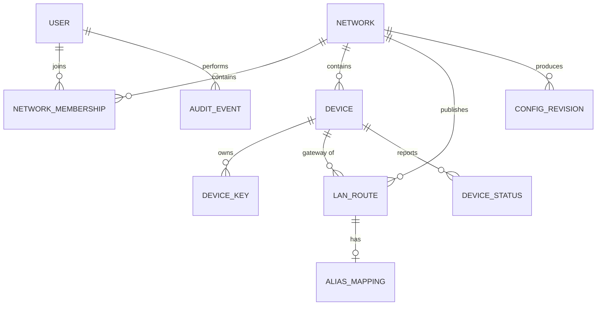

# 领域模型

> 来源：[存档 §5](../review/chatgpt-2026-10-13.md#_5-核心领域模型) + [ADR-004](../decisions/adr-004-overlay-ipam.md)、[ADR-006](../decisions/adr-006-alias-prefix-nat.md)、[ADR-009](../decisions/adr-009-config-revision-rollback.md)。本文为设计稿；实现以 `crates/meshlet-domain` 代码与测试为准，冲突时回到 [ADR](../decisions/index.md) 修订。

## 实体关系



## User（控制台用户）

| 字段 | 说明 |
|---|---|
| `id` | 标识 |
| `email` / 登录标识 | 本地管理员账号（ADR-010） |
| `password_hash` | Argon2id；不存明文 |
| `status` / `created_at` / `updated_at` | 状态与时间戳 |

第一版本地管理员即可；数据模型从一开始区分 Network 归属（§12.1）。

## Network（私人虚拟网络）

| 字段 | 说明 |
|---|---|
| `id` / `name` | 标识与名称 |
| `overlay_ipv4_cidr` | 创建时选定，**默认 `10.240.0.0/16`，创建后不可变**（ADR-004） |
| `status` / `created_at` / `updated_at` | 状态与时间戳 |

约束：不同 Network 默认隔离；设备不能因知道其他网络的虚拟 IP 获得访问权；CIDR 修改必须走冲突检查+迁移（第一版不提供）。

## Device（设备）

| 字段 | 说明 |
|---|---|
| `id` / `network_id` / `name` | 标识与归属 |
| `virtual_ipv4` | 网络内唯一；hub 保留地址不可分配（ADR-004） |
| `public_key` | 绑定设备身份；密钥与 Device 记录分离（DeviceKey） |
| `platform` / `status` | 平台与生命周期状态（`pending` / `active` / `revoked`） |
| `last_seen_at` | 最后证据时间（加入/心跳/上报到达时刻）——控制台「最后在线时间」 |
| `last_handshake_at` | 最近一次 WireGuard 握手（agent 从本地 `wg show` 读取后随心跳上报） |
| `last_report_at` | 最近一次 agent 心跳/状态上报（§14.1） |
| `created_at` / `revoked_at` | 创建与撤销时间 |

约束：撤销后服务端必须移除其有效 Peer 与授权；离线状态不能只看数据库旧值
（须按证据时间戳实时判定，见 §7.3）。

## Peer 与在线状态判定（§7.3、§12.4）

`meshlet-domain/src/presence.rs` 是纯函数判定引擎：输入三类证据时间戳
（`last_handshake_at` / `last_report_at` / 加入时刻），输出
`Presence { state, source, evaluated_at }`。

| 状态 | 判定条件 | 数据来源 |
|---|---|---|
| `online` | agent 上报在窗口内 | `agent_report` |
| `tunnel_only` | 仅握手在窗口内 | `handshake` |
| `offline` | 无新鲜证据 | 最新一条证据的来源 |

- **握手新鲜 ≠ 在线**（§12.4）：握手只证明隧道连通，不足以证明设备功能全部正常，
  故单独握手证据给出 `tunnel_only` 而非 `online`；
- 窗口阈值与判定时刻均可注入（默认 5 分钟 / 2 分钟），
  `fresh(now - ts <= window)` 含边界、未来时间戳视为新鲜（容忍时钟偏移）；
- 无法解析的时间戳按「不存在」保守处理；
- 判定结果必须随状态一起暴露**数据来源与更新时间**（§12.2）。

## DeviceKey（设备密钥）

公钥、密钥版本/指纹、创建/撤销时间、是否生效。**服务端不要求也不保存长期私钥**（ADR-010）。

## LAN Route（发布的真实局域网网段）

| 字段 | 说明 |
|---|---|
| `id` / `network_id` / `gateway_device_id` | 网段由哪个设备负责转发 |
| `destination_cidr` | 真实 LAN 网段 |
| `route_mode` | `direct`（普通路由）/ `alias`（经虚拟前缀） |
| `status` / `created_at` | 期望态 ≠ 已应用态 |

约束：同一网络内互相冲突的路由不能静默接受；返回路径模式（ADR-005）在此记录并显示。

## Alias Mapping（重叠网段虚拟前缀映射）

| 字段 | 说明 |
|---|---|
| `id` / `network_id` / `lan_route_id` | 绑定的 LAN Route |
| `alias_cidr` / `target_cidr` | **前缀长度必须相等**（ADR-006） |
| `translation_mode` / `status` | NAT 模式与应用状态 |

约束：删除 Alias 必须同步清理路由与 NAT 规则；转换前六项检查（§9.2）。

## Config Revision（配置版本）

| 字段 | 说明 |
|---|---|
| `network_id` / `revision` | 复合主键，network 内单调递增（§10.4 版本顺序） |
| `desired_config_hash` | 期望态哈希，幂等与重启恢复依据（ADR-009） |
| `apply_status` | `pending` / `applying` / `applied` / `failed` / `rollback_pending` / `rolled_back` |
| `created_at` / `applied_at` / `error_summary` | 时间与失败信息 |

状态机（合法跃迁）：

```text
pending → applying → applied
                └──→ failed → rollback_pending → rolled_back
```

实现：`crates/meshlet-domain/src/config_state.rs`（`ConfigLedger` 簿记 +
`ConfigApplyBackend` 注入后端 + `desired_config_hash` 确定性哈希——覆盖
overlay/hub/Active 设备/全部 LAN 路由（标签 `meshlet-desired-v2`，顺序不敏感），
Alias 纳入后扩展；纯函数 + 16 项单测）。
语义（§10.2–§10.4）：

- 每次期望配置变更（建网络、设备加入、撤销设备、路由增删）先 `record`
  新修订：初始 `pending`，此时**只完成了 DB 写入，尚未生效**；
- `apply`：`pending → applying → applied | failed`；已 `applied` 幂等重放，
  不再调用 backend（重复执行不破坏网络）；失败**含结果不确定**一律落
  `failed` + `error_summary`（不假装成功）；对 `failed` 原地重试非法，
  重试路径是记录新修订；
- `rollback`：只针对 `failed`（或未确认的 `rollback_pending`），只动 Meshlet
  自有对象（ADR-007）；回滚未确认则留在 `rollback_pending`，诊断合并保留；
- `current` = 最新未回滚修订，控制台与列表响应以它为准。

红线：控制台不得把数据库写入成功当作网络配置已生效。

## Peer AllowedIPs 推导（§7.2）

实现：`crates/meshlet-domain/src/peer_routes.rs`（纯函数 + 单测）。

原则：AllowedIPs 与目标路由一致，**不得全量指隧道**。第一版默认只路由三类网段：

| 视角 | AllowedIPs |
|---|---|
| VPS 侧某设备 Peer | 本机 Overlay `/32` + 该设备已发布（`Applied`）的 LAN 目标网段 + 对应 Alias 网段 |
| 客户端 → VPS Peer | 整个 Overlay + **其他**设备已发布的 LAN + Alias（自己发布的本地网段不回灌隧道，避免环路） |

约束：

- 只有 `Applied` 状态的 LAN Route / Alias Mapping 进 AllowedIPs；`Pending` / `Failed` 不进。
- Alias 只有在对应 LAN Route 已发布时才进。
- 设备虚拟 IP 必须在 Overlay 内（`PeerRouteError::DeviceOutsideOverlay`）。
- 结果去重 + 确定性排序（网络地址、前缀长度）。
- VPS 为每个设备创建独立 Peer（`hub_device_peers`）。

