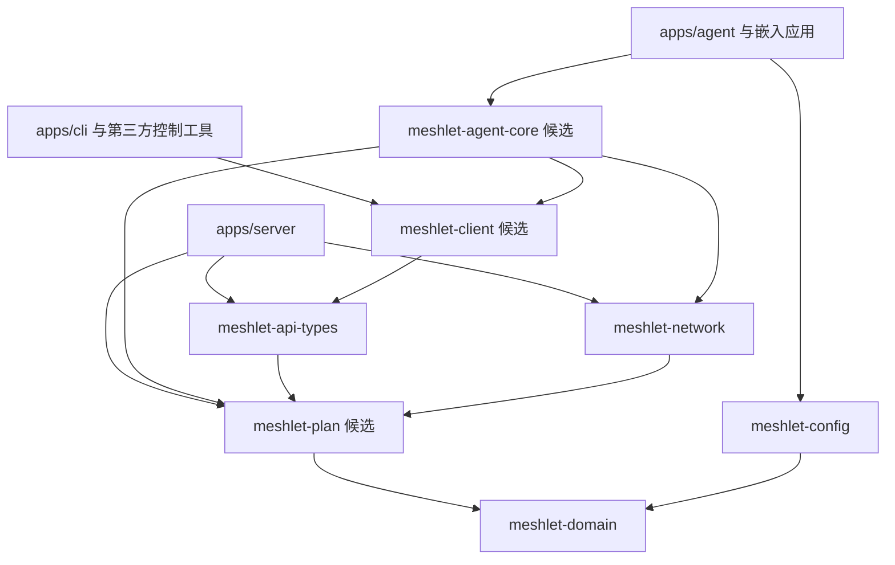

# 模块化与库复用设计（提案）

日期：2026-10-17。来源：用户希望开源项目分层、基础组网能力可以作为库复用，并询问虚拟网卡是否应成为所有使用场景的前提。

本文核对现有 workspace 后提出边界与迁移计划，尚未成为 Accepted ADR。本次不搬迁源码、不修改公开 API、不新增 crate 或依赖、不发布版本。基础正确性缺口仍见 [架构审查](../analysis/architecture-review-2026-10-17.md)；功能范围见 [个人组网调研](../analysis/personal-networking-comparison.md)。

## 1. 目标与拆分原则

目标是让外部项目能单独使用地址规划、策略/计划生成、系统网络配置或控制 API，而不必启动 Meshlet 产品的完整服务。产品仍按个人自托管规模部署。

模块、crate、进程是三种边界：先在 crate 内用模块梳理职责；有独立消费者、依赖负担或版本边界时再拆 crate；只有权限或运行生命周期需要独立时才拆进程。库分层不要求微服务部署，也不要求给每种 NAT、策略或平台都建一个包。

依赖应是有向无环图，不是所有能力必须串成一条长链。纯计算不依赖 HTTP、SQLite、系统命令或 GUI；管理 SDK 不依赖数据面执行器；基础网络库不依赖 Agent/Server；应用负责选择实现和运行方式。

## 2. 当前已经分层，但还没有形成完整的公共库边界

| 现有包 | 可复用的内容 | 实际耦合 / 缺口 |
|---|---|---|
| `meshlet-domain` | CIDR、IPAM、冲突检查、实体、状态机 | 同时包含密码哈希/认证，默认依赖 Argon2、rand 等；只用 CIDR 的网络调用方也带入这些依赖 |
| `meshlet-network` | `NetworkBackend`、Linux 执行器、网络快照、NAT 计划 | 混合计划、WireGuard 本地私钥参数与 OS 执行；`DevicePlan` 等传输对象位于执行库中 |
| `meshlet-api-types` | 错误响应、分页和少量公共类型 | 多数请求/响应仍定义在 `apps/server/src/service.rs`；Agent 也自行定义部分响应，不能当完整 SDK 契约 |
| `meshlet-config` | TOML 加载与校验 | 面向 Server/Agent 的产品配置；不应成为所有底层库的必需输入 |
| `meshlet-agent` | 对账函数、设备循环、注册与请求 | 虽有 `lib.rs`，仍把固定 HTTP 客户端、`SystemBackend`、文件状态、托盘和 Linux D-Bus 组合在一起 |
| `meshlet-server` | 路由构建、业务逻辑、计划生成 | 库入口主要供集成测试复用；hub/device 计划生成依赖应用内 `MeshState`，不是独立规划 API |
| `meshlet-cli` | 二进制入口 | 当前为应用；无需为“都是库”而强行公开内部实现 |

证据来自根及各包 `Cargo.toml`，以及 `crates/meshlet-network/src/lib.rs`、`apps/agent/src/agent.rs`、`apps/agent/src/server.rs`、`apps/server/src/service.rs` 和 `apps/server/src/device_plan.rs`。

`pub mod` 或存在 `lib.rs` 只说明可以在 Rust 中引用，不等于公开 API 已稳定，也不等于引用时依赖和副作用已经收敛。当前首先应收敛这些实际边界。

## 3. 建议的库层次

下表为目标职责，新增包名均为候选，实施前确认；近期保留现有四个基础 crate 的名字。

| 层 / 包 | 职责 | 不应承担 |
|---|---|---|
| 领域层：`meshlet-domain` | 地址、标识、实体约束、策略语义和纯状态判定 | 数据库连接、HTTP、提权、进程启动、默认密码认证依赖 |
| 计划层：候选 `meshlet-plan` | 类型化计划、校验、确定性生成、资源差异、所有权描述 | 执行系统命令、读取私钥、绑定某个 Server 状态结构 |
| 执行层：`meshlet-network` | 后端接口、OS 快照、网络应用/恢复；Linux/Windows 先作为内部模块 | 注册审批、轮询 API、控制台登录、桌面托盘 |
| 契约层：`meshlet-api-types` | 完整管理与 Agent DTO、错误契约、版本兼容边界 | Axum handler、SQLx row、系统执行器 |
| 调用层：候选 `meshlet-client` | 管理/Agent HTTP 客户端、超时、结构化错误、凭据注入 | 自动开启隧道、写系统配置、后台无限循环 |
| 协调层：候选 `meshlet-agent-core` | 拉取/接收期望、对账、应用确认、重试与停止 | 固定 GUI、安装服务、全局日志初始化、强制特定配置文件 |
| 应用配置：`meshlet-config` | 产品配置文件与默认值 | 强迫第三方按 Meshlet 的目录和进程布局运行 |
| 应用入口：`apps/*`、后续桌面组件 | CLI、运行时、日志、服务安装、存储和 UI 适配的装配 | 成为底层库反向依赖的对象 |

近期优先收敛 domain/network/api-types 的职责，再按真实调用需求提取 plan/client。Agent 核心先在现有包内分模块并注入依赖，确认外部嵌入场景后再独立成包。平台后端、Nginx、策略、服务代理先在相应库内分模块，不提前拆成十几个独立发布单元。

依赖示意，箭头表示“依赖于”，方括号中部分包尚未存在：

图中 Server 的 SQLite、认证和 HTTP 适配省略，仍由应用装配。DTO 可以承载计划而依赖纯计划类型，但不能经它反向引入操作系统后端。网络执行器所需的本地密钥材料不进入可下发的公共计划。

## 4. 需要先明确的公共接口

### 4.1 计划与执行分离

规划输入使用独立、可测试的网络快照/设备能力对象，不直接接收 Server 的 `MeshState`、数据库连接或 HTTP 提取器。输出应覆盖资源作用域、期望状态、应用前置条件和可解释的拒绝原因。

执行器消费类型化计划，报告实际结果及快照；差异计算和资源清理由稳定的网络/设备/资源标识约束。恢复上次成功计划的能力和 AR-04 一起设计，不把“删全部受管资源”包装成通用库的回滚承诺。

当前 `TunnelConfig` 既可序列化又含 `private_key: Option<String>`。服务端下发时虽然置空，后续公共边界仍应把可传输的期望计划与本地执行参数分开；密钥由本地提供者注入。不要以所有字段都 `pub` 的大结构体作为未经审视的长期 API。

### 4.2 协调器注入能力，不接管宿主程序

按实际可替换点注入：控制客户端、网络后端、本地状态存储、密钥提供者和事件接收端。时间/退避在需要确定性测试时可注入。避免为每个函数引入一个 trait。

提供单轮对账与显式停止/取消能力；长期运行接口的运行时要求写清楚。库不能强制创建自己的全局 Tokio runtime、初始化 tracing subscriber、调用 `process::exit`，或要求第三方只能调用一个永不返回的 `run() -> !`。

当前 `NetworkBackend` 有原生异步接口，而 Agent 使用具体 `SystemBackend` 的同步方法。抽取时先统一真正使用的接口和阻塞边界，再决定泛型或对象分发；不为形式完整同时维护两套行为不同的后端 API。

桌面托盘作为事件消费者，不成为协调器的必需依赖。后台使用者不应因为复用对账函数而编译 D-Bus/GUI；GUI 关闭也不应停止网络服务。

### 4.3 错误、权限与副作用

公开结构化错误类别，并保留诊断上下文，不能让调用方靠匹配 `pending approval` 文本判断状态。协议版本、Rust 包版本和配置文件版本分别定义兼容规则。

纯计划/客户端构造不创建接口、不修改路由、不安装服务。系统修改只在显式执行 API 发生；提权方式由宿主配置，不在通用库内默认运行 `sudo`。日志、错误和 `Debug` 不暴露凭据或私钥。

## 5. 虚拟网卡应放在可选择的接入边界

### 5.1 常规组网保留虚拟网卡

用户记忆正确：ZeroTier 常规网络创建虚拟接口，Tailscale 常规客户端也通过虚拟接口让未改造的应用访问虚拟地址。NetBird 管理其 WireGuard 接口，EasyTier 则同时提供常规 TUN 与受限的无 TUN 接入。[ZeroTier](https://docs.zerotier.com/start/)、[Tailscale](https://tailscale.com/docs/concepts/userspace-networking)、[NetBird](https://docs.netbird.io/about-netbird/ports-and-firewalls)、[EasyTier](https://easytier.cn/en/guide/network/no-root.html)

对于“未改造的浏览器、SSH、RDP、数据库和游戏通过虚拟 IP 像普通局域网一样通信”，虚拟接口是本项目应保留的主路径。Linux 内核 WireGuard 创建的是 WireGuard 网络设备，不应把所有虚拟接口都写成相同的 `/dev/net/tun` 实现。

“有虚拟网卡”不等于“每次手动开 VPN”，也不等于“所有上网流量都过 VPS”。桌面/服务器可一次安装注册后由后台服务自动维护，仅发布的私人网段进入隧道，普通默认路由保持用户选择；托盘用于状态与显式暂停。移动平台的 VPN 授权、状态提示、并存限制与后台机制另做实机验证，不能承诺与桌面一样完全无感。

### 5.2 无虚拟网卡是受限入口，不是全面更好的替代

| 接入方式 | 访问端虚拟网卡 | 用户/应用侧要求 | 适用范围与代价 |
|---|---|---|---|
| 常规 Overlay | 通常需要 | 安装后台客户端；应用使用远端 IP/名称 | 通用 IP 访问体验；需系统网络权限与路由管理 |
| 本地端口转发 | 可以不需要 | 后台 Agent 监听本地端口；应用改连 `localhost:端口` | 指定 TCP/UDP 服务；需要逐项映射与协议验收 |
| SOCKS/HTTP 代理 | 可以不需要 | 应用支持并配置代理 | 只覆盖经代理的连接；不能等同整机 IP 可达或所有 UDP/ICMP 行为 |
| 浏览器访问服务入口 | 浏览器端不需要 | 可达的 Web 网关与独立应用认证 | 适合 Web 服务；远程入口可能涉及公网显式发布，不替代完整私人网络 |
| LAN 网关代接入 | LAN 内设备可不需要 | 网关运行客户端；相关返回路由/SNAT 正确 | 已有点对网能力可利用；任意异地访问端仍需到网关的路径 |

Tailscale 官方提供无 TUN 的 SOCKS5/HTTP 用户态模式，主要面向不能创建隧道设备的环境。EasyTier 的无 TUN 节点可被虚拟网络访问，主动访问可配 SOCKS/端口转发；这是用户态网络/代理实现，并非把开关关掉就自动获得相同宿主机路由体验。[Tailscale 用户态](https://tailscale.com/docs/concepts/userspace-networking)、[EasyTier 无 TUN](https://easytier.cn/en/guide/network/no-root.html)、[EasyTier 端口转发](https://easytier.cn/guide/network/port-forward.html)

frp 的 TCP/UDP/HTTP 等服务代理也是无虚拟网卡方案的参考，但它解决服务暴露/转发问题，和为任意应用提供完整虚拟局域网的目标不同。[frp 代理配置](https://gofrp.org/zh-cn/docs/reference/proxy/)

本项目没有已实现的无网卡传输后端。当前把 Nginx upstream 指向 Overlay IP，Nginx 所在机器仍依赖该网络路径；给 Nginx 加配置不能使底层 WireGuard 无网卡运行。真正无网卡需要用户态网络栈、已认证代理连接或反向服务隧道等数据面，须先验证维护成本和业务限制。

### 5.3 模块化为可选入口留边界，不立即开发第二套网络

近期主线是常规虚拟网卡 + 自动运行 + 分流路由，把用户感知的反复启停和配置负担消掉。只有明确出现“无法获得网络权限”“容器无 TUN”“只访问少数服务”等场景，才为指定入口增加无网卡能力。

计划与契约不要让每项服务都必须包含一个非空 `TunnelConfig`。通用服务描述、访问策略与执行回执可以共享，Overlay 计划和服务代理计划分别验证；OS 网络执行器只负责前者。候选无网卡服务执行模块应能在不依赖网络后端、不创建接口的条件下单独构建与测试。

服务入口与通用组网可以共存，但不承诺两者都在第一期实现，也不把无网卡当作解决复杂穿透的捷径。设备直连、relay、HTTPS 回退是传输路径问题，虚拟接口只是宿主应用接入方式，两者需分别设计。

## 6. 对外复用与开源规范

| 使用者目标 | 应依赖 | 验收方式 |
|---|---|---|
| 检查 CIDR/分配地址 | 轻量 domain | 无 HTTP/DB/Argon2/GUI 依赖的最小消费示例 |
| 生成/校验设备配置 | 纯计划库 | 无 root、无服务端、无系统命令的确定性测试 |
| 在自己的网络程序中执行配置 | network + 所需计划 | 调用者显式选择作用域和权限；隔离环境执行验收 |
| 从其他系统控制 Meshlet | client + DTO | 不链接 WireGuard/DB/GUI；测试超时与稳定错误分类 |
| 嵌入自有桌面/后台程序 | 协调核心 + 选定适配器 | 生命周期由宿主控制；能启动、单轮执行、停止及恢复 |

可选依赖使用 Cargo features，平台特有依赖使用目标条件。features 用于编译能力，设备选择哪个网络、是否启用代理和权限策略属于运行时配置。features 应尽量可叠加；不要用互斥 feature 代表当前活动网络或可执行权限。参见 [Cargo features](https://doc.rust-lang.org/cargo/reference/features.html)。

新增公开 crate 应有 README、职责和非目标、最小可运行示例、错误/权限说明、支持平台、明确 MSRV 与文档测试。当前先提出 MSRV 与选择依据，不随意填写未验证的最低版本。公开依赖类型、trait 扩展和 feature 变化纳入兼容性评审，参见 [Cargo SemVer](https://doc.rust-lang.org/cargo/reference/semver.html)。

工作区仍共享版本/依赖配置；库发布前补 repository/documentation/readme 等元数据、包内容检查和可解析的版本依赖，不能假定仓内 path 依赖即构成可发布包。参考 [Cargo workspace](https://doc.rust-lang.org/cargo/reference/workspaces.html) 与 [发布流程](https://doc.rust-lang.org/cargo/reference/publishing.html)。本次不运行发布、不改版本号；正式发布仍由用户明确触发。

对贡献者补充依赖方向、模块所有权、功能验收方法与特权测试前置条件；贡献指南、安全问题报告入口和变更记录按实际流程建立。先在同仓作为内部消费者跑通，再考虑稳定对外发布。纯 Rust crate 是近期复用途径，不默认承诺动态插件 ABI、C ABI 或其他语言 SDK。

## 7. 渐进迁移与验收

| ID | 工作 | 完成门槛 |
|---|---|---|
| MOD-01 | 固化职责/依赖规则，列公共 API 与兼容范围 | 依赖图不含底层到应用的生产反向依赖；候选包与已存在包明确区分 |
| MOD-02 | domain 认证依赖减重；DTO 归位 | CIDR/IPAM 消费者不引入密码哈希；Agent/Server 共用真实 DTO，错误不靠文本匹配 |
| MOD-03 | 提取纯计划边界 | 规划不依赖 `MeshState`/OS 执行；下发对象不含本地私钥；AR-01/02/04 的资源与回执语义不丢失 |
| MOD-04 | 网络后端与协调核心解耦 | Agent 通过统一后端边界调用；headless 消费无托盘依赖，能由宿主停止；保持真内核验收 |
| MOD-05 | 按需提取 HTTP client 与最小外部消费示例 | 只用 SDK 不构建执行器；各复用场景能在独立消费项目验证；包文档和支持范围完整 |
| MOD-06 | 常规网卡自动运行体验；无网卡入口可行性评估 | 安装注册一次、开机恢复、私人网段分流；有明确场景才对代理/用户态方案做原型 |

不进行全仓一次性搬迁。修 AR-01/AR-02/AR-04 时同步定义计划、资源和回执边界，避免先稳定错误契约再推翻。先内部模块重构，再按可验证的复用点提包；没有外部稳定消费需求的应用代码保留在应用中。

验证分层进行：纯库单测/文档示例、无默认 feature 与平台构建、独立消费者依赖检查、真实内核网络用例、实际安装/生命周期。只验证重命名后的编译不足以证明迁移成功。本文只记录设计；上述代码验收均未因本次文档构建而完成。
