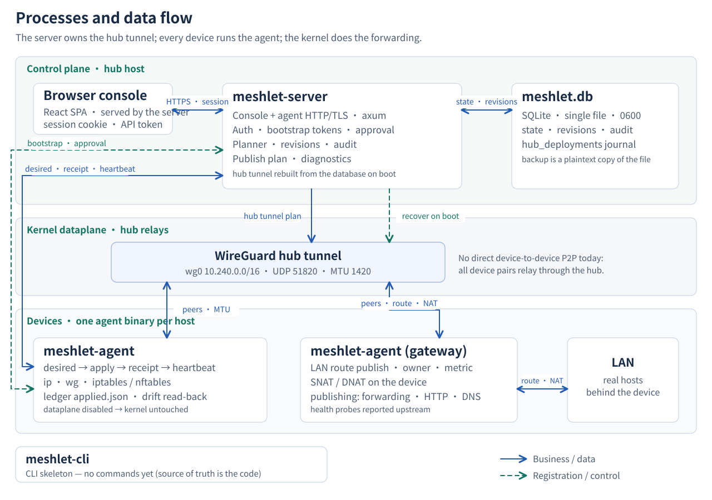

# Process Topology

<picture>
  <source media="(max-width: 767px)" srcset="../public/architecture/system-en-mobile.svg">
  
</picture>

Solid lines carry business data: console traffic, desired plans and receipts, hub tunnel plans, kernel changes. Dashed lines carry registration and recovery.

## Three zones, four binaries

**Control plane, on the hub host.** `meshlet-server` serves the console and the agent HTTP/TLS API, and owns authentication, bootstrap tokens, approval, the planner, revisions and the audit log. It persists everything in one `meshlet.db` SQLite file (0600, single file). The server also owns the hub's `wg0` and rebuilds that tunnel from the database on boot.

**Kernel dataplane.** The `10.240.0.0/16` WireGuard overlay on UDP 51820, MTU 1420. There is no device-to-device P2P today: every device pair relays through the hub.

**Devices.** One `meshlet-agent` binary per host. It polls the desired plan, applies it with `ip`, `wg`, iptables or nftables, posts the receipt and a heartbeat, and keeps a local ledger (`applied.json`) for drift read-back. A gateway agent additionally publishes LAN routes with owner and metric, does SNAT/DNAT on the device, and runs service publishing for forwarding, HTTP and DNS.

**`meshlet-cli`** is a skeleton and has no commands yet.

## Source of truth

The diagram follows the code as it stands, not the earlier documents. Two places where the documents and the source disagree: `apps/agent/src/server.rs` is a client of the hub API, not a local listener, and the hub's `wg0` lives in the server process (`hub_public_key`, `hub_backend_factory`, `hub_deployments`), not in the agent. Where a document and the source disagree, the source wins.

SVG variants

- [`system-en.svg`](./system-en.svg) — 1280 × 900, desktop
- [`system-en-mobile.svg`](./system-en-mobile.svg) — 480 × 1480, vertical re-layout, not a proportional shrink

