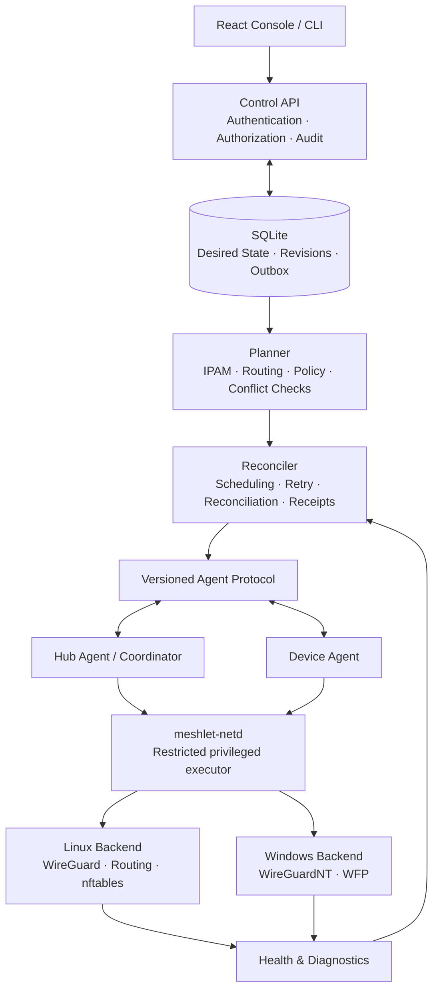

# Target Architecture (Draft)

> Nature: review transcript of a ChatGPT shared-page refactor plan (2026-10-20; user link `t_6ad791db...`; user directive: use it as the new implementation baseline).
> Constraint: this document is the source for Meshlet's target design and implementation order. `TODO.md` was rewritten from it; the old TODO is archived and is not a premise.

I will design Meshlet from a **Greenfield Target Architecture**: no compatibility with the old API, old database schema, old configuration files, or existing module layout is assumed. The data model, protocols, migration system, and network execution backend may be rebuilt where necessary.

The design principle is: **establish the correct domain model, security semantics, and state consistency first, then decide how code is organized; do not compromise to preserve the current implementation.**

Combining the repository's latest `TODO.md`, I define the design goal as personal self-hosted network infrastructure: device networking, multiple networks and trust groups, remote LAN access, overlapping prefixes, TCP/UDP port forwarding, HTTP service publication, and reliable network diagnostics.

Core decisions come first:

- **Separate the control plane from the data plane completely**: the Rust control plane owns identity, policy, network planning, and orchestration; device Agents execute; the operating-system kernel performs the actual forwarding.
- **Desired state is the single source of truth**: database state fields, caches, and kernel state no longer compete for authority.
- **Pure-function network planner + declarative executor**: compute a complete plan, check conflicts and security policy, then have executors apply the difference.
- **Default deny, not default trust**: networks, Segments, devices, service entry points, and forwarding rules all require explicit authorization semantics.
- **Recoverability over feature count**: partial failure, disconnection, restart, upgrade, and configuration revocation all need verifiable convergence mechanisms.
- **Unified resource model, separate execution backends**: Overlay, LAN routes, Alias, port forwarding, and HTTP publication share identity, policy, and state management, but not one vague NAT implementation.

The complete target design follows.

## 1. Target architecture: modular-monolith control plane + separate privileged executor

I do not recommend splitting Meshlet into microservices, but I do recommend clear, enforced boundaries between **management authority, network planning, state coordination, and operating-system execution**.



### 1.1 What each process should own

| Component | Sole responsibility | Must not do |
|---|---|---|
| `meshlet-server` | Management API, identity, database, audit, orchestration | Execute arbitrary shell commands directly |
| `meshlet-planner` | Compile desired configuration into a deterministic execution plan | Modify the kernel or access the database |
| `meshlet-reconciler` | Schedule execution, track results, repair drift | Implement its own IP routing algorithms |
| `meshlet-agent` | Device identity, fetch plans, coordinate local execution, report receipts | Trust arbitrary remote instructions directly |
| `meshlet-netd` | Perform restricted privileged network operations on the host | Expose a generic command-execution interface |
| Linux/Windows backend | Map typed plans to OS network mechanisms | Maintain a second copy of business state |
| Console / CLI | Operate resources, display state, diagnose problems | Derive or fabricate applied state |

I specifically recommend adding `meshlet-netd`.

The repository already limits privileges through a dedicated service user and Linux capabilities, but the target design can further separate the web management plane from network-management authority.

`meshlet-netd` communicates with the service process over a local Unix domain socket, verifies caller identity and request type, and accepts only explicit operations such as:

- Apply a verified HubPlan.
- Remove a specified managed Peer.
- Reconcile a specified set of managed routes.
- Atomically replace a specified managed firewall rule set.
- Read actual kernel state.
- Roll back to a verified safe configuration.

It never exposes a generic `exec(command)` interface.

Windows uses a corresponding protected Windows Service instead of granting administrator rights directly to the desktop console.

**Establish this security boundary from the beginning; do not wait for a future security incident to split it out.**

---

## 2. Redesign the domain model first

The easiest way for Meshlet to keep growing complicated is to treat networks, trust groups, routes, Aliases, port forwarding, and HTTP service publication as different kinds of "network configuration".

These objects are related, but they are not the same resource type.

### 2.1 Unified domain model

- **Network** — an independent WireGuard network, address space, network-level policy, and configuration-revision domain.
  - **Segment** — defines which devices belong to the same trust domain and which cross-group communication is permitted.
  - **NetworkAttachment** — which network a device joins, what address it receives, which Segment it belongs to, and what gateway role it takes.
  - **RouteAdvertisement** — which real LAN prefix a gateway publishes, how the path is selected, and how return traffic is routed.
  - **PrefixTranslation** — resolves address conflicts between different LANs through an Alias prefix, explicitly defining the original target, translated target, and scope.
  - **Service / Exposure** — describes the target service, listener address, protocol, port, HTTP domain and path, and who may access it.
- **Policy** — the unified authorization model controlling actual access between devices, Segments, remote LANs, and published services.

### 2.2 Five resource types that must be distinct

| Resource | Problem it solves | Responsibility it must not take |
|---|---|---|
| Network | Which virtual network? | Does not directly represent a service port |
| Segment | Which devices trust each other? | Does not choose routing gateways |
| Route | Which target prefix uses which gateway? | Does not mean the user is authorized to access it |
| Prefix Translation | How are overlapping addresses distinguished? | Does not replace access control |
| Service Exposure | Which entry point maps to which service? | Is not equivalent to opening the whole target prefix |

This is a key architectural decision.

For example, suppose you have two NAS devices, two VPS instances, and two remote LANs that both use `192.168.1.0/24`.

The correct model is:

- Two different gateways, each publishing one real LAN prefix.
- Two independent Alias prefixes, each mapped to its corresponding real LAN.
- Two independent route targets.
- Two access policies that may differ.
- Per-service port-exposure rules for each target service.

Adding one `Route` or `Alias` record cannot implicitly accomplish all of this.

### 2.3 Device and NetworkAttachment must be separate

I recommend separating device identity from device network membership.

- `Device`: a physical or virtual device with a Meshlet Agent and an independent identity.
- `NetworkAttachment`: this device's participation in one Network.
- `DeviceCredential`: device authentication credentials.
- `DeviceAddressAssignment`: the device's address allocation in a specific network.
- `DeviceCapability`: execution capabilities the device actually supports, such as IPv4, IPv6, LAN routing, or specific firewall features.

This way, even when one machine later joins multiple Networks, it does not need to be duplicated into unrelated devices.

Each Attachment independently owns its network address, Segment, gateway role, and application state. Revoking a device in one network must not automatically revoke it in another.

The current repository lists one-machine/multiple-networks as deferred; I recommend adopting this data model now while scheduling full execution support for a later phase.

---

## 3. Desired state must be the single source of truth

This is the most important design in the entire system.

I recommend dividing system state into four categories and forbidding them from being mixed.

1. **Desired State** — what the user wants the network to become. Stored in the database and the business source of truth.
2. **Revision / Plan** — immutable configuration revisions and execution plans: the snapshot, hash, execution targets, and operation dependencies for a generation of desired state.
3. **Observed State** — actual observed state read from WireGuard, OS routes, firewalls, and Agents.
4. **Health State** — whether real traffic is reachable, whether target TCP/UDP services are available, and whether HTTP services are healthy.

### 3.1 How one configuration change should run

Suppose the user creates a new LAN route.

1. Read the current network desired state and construct a modified candidate state.
2. Run address-conflict, gateway-selection, and authorization checks.
3. Compile the candidate state into a deterministic network plan, ensuring planning succeeds.
4. Commit the resource change, immutable revision snapshot, audit record, and pending task in one transaction.
5. The background Reconciler invokes the Hub and the relevant device executors.
6. Executors apply the plan item by item, read actual state, and verify it.
7. Each target returns an application receipt with the revision number and plan hash.
8. The system independently verifies end-to-end connectivity and business health.

A successful database commit means only that the new desired state is stored; it does not mean the network is live.

The repository already implements revision state, device receipts, and rejection of stale receipts; the target design should preserve these principles and unify them into a formal state model.

### 3.2 Revision state must not remain a simple `Applied`

Give every Revision an independent execution record:

| State | Meaning |
|---|---|
| `Pending` | Committed, waiting for execution |
| `Preparing` | Checking targets and preparing changes |
| `Applying` | At least one target is applying |
| `PartiallyApplied` | Some targets succeeded; others have not converged |
| `Converged` | All required targets have reached their desired state |
| `Failed` | This execution failed; the current desired state still exists |
| `Superseded` | A newer desired revision replaced it |

Business health is recorded separately, for example `Healthy`, `Degraded`, `Unreachable`, or `NotProbed`.

Thus, even if every device has installed the configuration but the target NAS is down, Meshlet can still express accurately that "network configuration converged; business service unavailable".

### 3.3 Rollback must create a new revision

Do not directly modify historical Revisions, and do not secretly change database state back to old values after a failed execution.

Suppose:

- R1 is currently running normally.
- R2 adds a route.
- R2 fails to apply.
- The system restores the last safe running state.

R2 is still a real failed change that occurred. If the user decides to undo it, create R3 whose desired state restores the business configuration corresponding to R1.

Add an important safety rule:

**Rollback must not restore permissions, device credentials, or authorization relationships that have been explicitly revoked.**

For example, if a device has been revoked, it must never regain access merely because it still appears in a last-good snapshot.

---

## 4. Planner: centralize all network planning in one pure-logic module

I recommend a standalone `meshlet-planner` that does not access the database, run system commands, or hold private keys.

Its input is an immutable Network Snapshot plus related device capabilities and security policy.

Its output is a deterministic Plan.

```text
Desired Network Snapshot
          |
          v
     Schema Validation
          |
          v
      IPAM / CIDR
          |
          v
    Conflict Analysis
          |
          v
   Route Computation
          |
          v
   Policy Compilation
          |
          v
   Service Compilation
          |
          v
     Device Plans
     Hub Plan
          |
          v
    Plan Hash / Diff
```

### 4.1 What the Planner must own

- Overlay address allocation and address-conflict checks.
- Target prefixes, gateways, and priority computation for all LAN routes.
- Translation rules for overlapping-prefix Aliases.
- Segment authorization and cross-network access policy.
- TCP/UDP port-forwarding rules.
- HTTP domain, path, and upstream target rules.
- Deciding which operations are executable based on device platform and capabilities.
- Producing an independent plan for each device.
- Producing the global Peer, route, and firewall plan required by the Hub.
- Canonically serializing and hashing every plan.

### 4.2 Conflict checking must be global and independent of creation order

This is an area the current design must strengthen. The existing TODO already notes that more complete conflict checks are needed among Overlay, Alias, Direct, and shared forwarding prefixes.

I recommend a unified conflict analyzer instead of continuing to write independent checks in every CRUD handler.

Conflict analysis must consider at least:

- Overlay CIDRs within the same Network.
- Containment between Segments and the Overlay.
- LAN prefixes published by different gateways.
- Mapping targets of different Aliases.
- Intersections between Direct routes and Alias routes.
- Local LANs actually connected to the same device.
- Existing host routes and listening ports.
- The same listener address, protocol, and port being used by multiple services.
- Selection and failover rules when multiple gateways publish the same target.

Conflict results should be typed errors, for example:

- `OverlayOverlap`
- `AliasPrefixConflict`
- `AmbiguousGateway`
- `LocalRouteConflict`
- `ListenerConflict`
- `UnsupportedBackendCapability`

Business decisions must not depend on string error messages.

### 4.3 Route selection must be deterministic

If two gateways both publish `192.168.10.0/24`, the system must not choose one arbitrarily.

The target model should explicitly contain:

- Route owner.
- Target prefix.
- Gateway.
- Route priority.
- Health-check conditions.
- Failover policy.
- Return-path mode.
- Alias mapping relationship.
- Owning Network and visible Segments.

Deny ambiguity by default; allow multiple gateways to compete for the same target only when the user explicitly configures priority or an unambiguous redundant-route policy.

---

## 5. Security model: from network reachability to explicit authorization

I recommend splitting security design into three distinct layers.

### 5.1 Layer 1: device identity and network-join approval

First device registration:

1. The user generates a one-time Bootstrap Token.
2. Only the Token digest is stored, with an expiry and usage limit.
3. The Agent registers over HTTPS and submits its public key.
4. The server creates a pending device.
5. The user approves the device; the server establishes an independent device identity and long-lived credential.
6. Subsequent communication uses device identity authentication and supports credential rotation and revocation.

The target design should use HTTPS plus device-level mTLS identity. The initial registration Token is only for establishing identity and should not become the device's long-lived pass.

Neither server nor Agent private keys should enter public configuration snapshots, ordinary API responses, or logs. The backup process must also clearly separate the business database from device keys.

### 5.2 Layer 2: Segments and access policy

Keep Segments inside a Network, but formally adopt the following authorization contract:

- Create a default Segment when creating a Network.
- The default Segment may use an explicit "trusted group" policy template.
- Custom Segments do not allow proactive cross-segment access by default.
- Cross-Segment authorization must have an explicit direction.
- Authorization should support protocol, port, source, and destination restrictions.
- Revoking authorization must promptly block new unauthorized traffic.
- When a device is revoked, the Hub must reject its traffic and must not rely on the client to update itself.
- Existing connections must follow explicit revocation semantics.

I recommend keeping the convenient same-segment-trust mode, but it should be an explicit policy configuration, not an implicit permanent `ACCEPT` in the kernel.

### 5.3 Layer 3: the execution layer enforces policy

WireGuard `AllowedIPs` can constrain routes and Peer address ownership, but it cannot alone provide complete application access control.

Therefore:

- The Linux Hub uses a separate managed nftables rule set.
- Every Network's forwarding path has an explicit identity and policy owner.
- Cross-segment traffic passes through a stateful firewall.
- Service entry points enforce separate target and port authorization.
- Devices may also enforce host-level firewall policy locally when needed.
- Windows uses real firewall mechanisms such as Windows Filtering Platform, not just route configuration that assumes access is restricted.

The repository's Segment design already requires both device-side route visibility and Hub firewall enforcement.

### 5.4 Choosing the Linux network execution backend

Target proposal:

| Capability | Approach |
|---|---|
| WireGuard | Linux kernel WireGuard |
| Interfaces and routes | `iproute2` with strictly parameterized calls |
| Firewall | nftables with an independent managed rule set and atomic updates |
| NAT | Explicit typed DNAT, SNAT, and NETMAP rules |
| State reading | Query the actual kernel, not only a local ledger |
| Execution authority | `meshlet-netd`'s restricted operation interface |

I do not recommend rewriting every Linux network operation as a low-level Netlink implementation from day one. What matters most is verifiable execution, atomically updatable rules, clear resource ownership, and recoverability after failure. nftables is the right firewall target for the new architecture, but that does not mean every feature must immediately become a low-level protocol implementation.

---

## 6. LAN, Alias, port forwarding, and HTTP publication must use different execution engines

This is the principle I most want the target architecture to preserve.

### 6.1 LAN routing engine

Responsibility: let Overlay devices reach remote LANs.

Owns:

- Route publication and revocation.
- Gateway selection.
- Direct routes.
- Return paths.
- Necessary SNAT.
- Gateway health and failover.
- Visibility and conflict checks for overlapping prefixes.

### 6.2 Alias mapping engine

Responsibility: solve overlapping address spaces.

For example:

- Local LAN: `192.168.1.0/24`
- Remote site A: `192.168.1.0/24`
- Remote site B: `192.168.1.0/24`

The user reaches A and B through two different virtual Alias prefixes. The system must translate the destination address to the correct real prefix and ensure return traffic still belongs to the correct mapping.

Alias cannot be merely a UI label. It must have a clear mapping direction, address range, gateway, return mode, applicable policy, and deletion/cleanup semantics.

### 6.3 L4 service publication engine

Responsibility: map an explicit TCP or UDP entry point to a target service, not open the whole target prefix.

Define `PortForward` independently:

```text
PortForward {
    id,
    network_id,
    listener_address,
    protocol,
    external_port,
    backend_device_id,
    backend_address,
    backend_port,
    access_policy_id,
    enabled
}
```

This is a conceptual structure, not the final serialization format.

It is important to distinguish:

- Entry listener port.
- Upstream service port.
- TCP versus UDP.
- Whether the target is a local service.
- Whether the target is a remote Overlay device.
- Whether the target is a remote LAN.
- Whether DNAT, SNAT, or a return route is required.
- Which rules must be cleaned up when the service is revoked.

### 6.4 HTTP service publication engine

Responsibility: forward HTTP/HTTPS requests to specific services based on domain and URL path.

For example:

- `nas.example.com` → NAS web UI.
- `git.example.com` → Git service.
- `example.com/api/` → a specified API service.
- `example.com/admin/` → another protected service.

HTTP publication should not be implemented as a large set of scattered iptables rules.

I recommend introducing a separate `ServicePublisher` interface responsible for:

1. Validating domain, path, upstream address, and authorization.
2. Generating the complete target configuration.
3. Validating configuration correctness.
4. Atomically updating or safely reloading.
5. Verifying upstream connectivity.
6. Retaining the last valid configuration on failure.
7. Reporting configuration state and business health separately.

For HTTP/HTTPS, first evaluate a Meshlet-managed Caddy instance as the reverse-proxy backend to leverage mature TLS and configuration validation; if Nginx is ultimately selected, keep the same `ServicePublisher` abstraction. Never overwrite a user's existing Nginx/Caddy configuration directly.

### 6.5 DNS and service catalog

DNS should be an independent feature, not an excuse to modify the system DNS of every device.

Recommendations:

- Provide configurable internal domains.
- Resolve only Meshlet-managed services by default.
- Support split DNS without overwriting devices' existing public DNS configuration.
- Delete corresponding records when a service is deleted.
- DNS results follow Network, Segment, and service visibility policy.
- The service catalog shows service addresses, target devices, health, and authorization requirements.

---

## 7. Rust workspace: rebuild around explicit crate boundaries

No microservices are needed, but real modularity is.

Proposed target layout:

```text
meshlet/
├── apps/
│   ├── server/                 # Control API and orchestration
│   ├── agent/                  # Device-side coordinator
│   ├── netd/                   # Privileged host network executor
│   └── cli/                    # Administration and diagnostics
├── crates/
│   ├── meshlet-domain/         # Pure domain model
│   ├── meshlet-ipam/           # Address allocation and CIDR
│   ├── meshlet-policy/         # Authorization semantics
│   ├── meshlet-planner/        # Deterministic network compiler
│   ├── meshlet-protocol/       # Versioned Agent protocol
│   ├── meshlet-store/          # Persistence interfaces
│   ├── meshlet-store-sqlite/   # SQLite implementation
│   ├── meshlet-control/        # Application use cases
│   ├── meshlet-reconciler/     # Desired/observed convergence
│   ├── meshlet-net-backend/    # Platform backend contracts
│   ├── meshlet-net-linux/      # WireGuard, routes, nftables
│   ├── meshlet-net-windows/    # WireGuardNT, WFP, routes
│   ├── meshlet-service-l4/     # TCP/UDP forwarding
│   ├── meshlet-service-http/   # HTTP service publication
│   └── meshlet-observability/  # Logs, metrics, diagnostics
├── console/
├── migrations/
├── protocol/
├── docs/
└── scripts/
```

Dependencies between these modules should be unidirectional:

- `domain` does not depend on Axum, SQLite, or the operating system.
- `ipam`, `policy`, and `planner` perform no side effects.
- `store` owns only persistence abstractions and transactions.
- `control` owns business use cases and transaction boundaries.
- `reconciler` owns coordination and recovery.
- Platform backends perform only concrete network operations.
- `server`, `agent`, and `netd` own process lifecycle and dependency assembly.

This aligns with the repository's existing modularity proposal, but makes the target dependency boundary a hard constraint rather than prioritizing compatibility with the current crate layout.

---

## 8. Persistence and concurrency: no full event sourcing, but retain immutable history

For Meshlet's current personal self-hosting positioning, I still recommend SQLite and do not recommend introducing PostgreSQL, Redis, message queues, and microservices early for architectural completeness.

The target data layer should include:

| Data category | Storage strategy |
|---|---|
| Devices, networks, routes, authorization, services | Normalized relational tables |
| Current desired state | Transactionally updatable resource model |
| Revision snapshots | Immutable and verifiable |
| Apply Attempt / Receipt | Trackable execution records |
| Audit log | Append-only audit records |
| Outbox | Tasks committed in the same transaction as business changes |
| Actual kernel state | Live readback and rebuildable observation data |
| Private keys and long-lived credentials | Separate protected local key store |

I do not recommend making every operation a full event-sourced stream. For this project, normalized business tables + immutable revision snapshots + audit logs + a transactional outbox are easier to maintain.

### Concurrency

Network changes need explicit concurrency boundaries:

- Changes to the same Network use optimistic version checks or network-level serialization.
- Different Networks may apply in parallel.
- Local execution on the same device should be serialized so plans do not overwrite each other.
- External network operations run only after the database transaction commits.
- Task writes and business changes are made atomic through the Outbox.
- Every failure has an explicit retry, timeout, cancellation, and final state.

The database must not wait in a long transaction for kernel commands, and the system must not claim that the whole business transaction is complete before external operations succeed.

### Backup and restore

A backup should include:

- Desired state.
- Network, device, authorization, route, and service configuration.
- Required revision history and audit records.
- Device registration and revocation state.

Private keys should be protected separately; if a backup includes keys, it must be an explicitly selected, encrypted recovery package.

Restoring SQLite must not by itself declare the service restored. The system must re-read desired state, check credentials and keys, compile plans, and then reconcile actual kernel state. Existing repository documentation already notes that restoring SQLite alone will not automatically restore the Hub's kernel state.

---

## 9. Agent protocol and state consistency

I recommend continuing to use HTTPS + JSON as the initial control protocol; there is no need to force gRPC in the name of modernization.

However, protocol definitions must be unified:

- The public management API uses OpenAPI as its contract source.
- Agent Plans use a separate, versioned Schema.
- Generate Rust and TypeScript types from the Schema where possible.
- Every Plan contains the protocol version, revision number, target ID, plan hash, and required capabilities.
- An Agent accepts only protocol versions and plan types it supports.
- Explicitly reject incompatible versions; silent downgrade is forbidden.
- Device receipts must exactly match the current desired revision and plan hash.
- Retries use idempotency identifiers and must not repeat irreversible side effects.

Dropping compatibility with the old protocol does not mean protocol versioning can be ignored. **Old versions may be dropped, but version boundaries must not become ambiguous.**

Agents should use jittered exponential backoff and long polling so a large fleet does not request simultaneously after a server restart. Real-time push may be an optimization, but it cannot be the only task-delivery mechanism; even if a push is lost, an Agent must eventually discover new revisions.

---

## 10. Executors must have verifiable recovery capability

A network change is not an ordinary CRUD operation. It may modify multiple interdependent kernel resources, so a database transaction cannot be expected to roll back all external side effects.

I recommend that every network execution plan support:

- `Prepare`: validate preconditions and resource ownership.
- `Apply`: execute operations in dependency order.
- `Verify`: read actual state back from the kernel.
- `Commit`: record the successful plan and observed results.
- `Compensate`: perform bounded compensation and recovery on failure.
- `Reconcile`: continuously repair differences between desired and actual state.

Compensation is not unconditional restoration of all old rules. Safe revocation must take priority over restoring the old state.

For example, when revoking a device, first block its forwarding authorization at the Hub, then clean up related state. Even if an Agent is offline, it must not continue reaching revoked targets through the Hub.

Similarly, when expanding access, prepare routes and related resources first and open the actual firewall authorization last, so privileges do not accidentally expand midway through application.

These execution orders must be explicit contracts between the Planner and executors, not accidental call orders in individual handlers.

---

## 11. Redesign the test system as well

I recommend five test layers, each with an independent pass criterion.

| Layer | Test content | Acceptance focus |
|---|---|---|
| L1: pure logic | IPAM, CIDR, conflict analysis, policy, plan compilation | Determinism, boundary conditions, property tests |
| L2: storage and API | Transactions, audit, authorization, revisions, Outbox | No orphan resources, concurrency safety, no commit on failure |
| L3: real kernel | Linux network namespaces, WireGuard, nftables | Real data-plane allow and deny |
| L4: platform integration | Windows VM, service startup, permissions, routes, firewall | Boot recovery, reboot, revocation, upgrade |
| L5: deployment acceptance | Empty VPS, backup/restore, upgrade/rollback, real devices | End-to-end usability and recoverable failures |

The repository already has many Linux netns tests and clearly distinguishes local tests from real-deployment acceptance. The target design should retain that principle while filling in real Windows platform tests and real-VPS acceptance.

I also recommend adding the following automation:

- Property tests for CIDR conflict detection.
- Tests that the same input always produces the same Plan Hash.
- Tests that random change order does not alter the final plan.
- Failure injection at every execution stage, verifying the final state.
- Negative connectivity tests for every revocation operation.
- Tests that deleting resources leaves no residual routes, Peers, NAT, or listeners.
- Tests for database backup, restore, key rotation, and credential revocation.
- In strict data-plane CI, missing dependencies must fail; skips cannot count as passes.

Test coverage may be a metric, but it should not be the only acceptance criterion. For network infrastructure, **unauthorized traffic actually failing to pass through the real kernel** matters more than whether a function reaches 100% line coverage.

---

## 12. Final implementation order

Even without compatibility with the old structure, I recommend implementing by dependency rather than rewriting every module simultaneously.

1. **Rebuild the foundation** (highest priority)

   Redefine the domain model, Revision, Plan, Receipt, protocol Schema, and crate dependencies. Build the pure Planner, SQLite transactions and Outbox, and the privileged executor interface.

2. **Reliable Linux network infrastructure**

   Rebuild the WireGuard Hub, Peer management, routing, nftables, safe revocation, drift detection, last-good recovery, and single-instance multi-network isolation.

3. **Unified network planning and conflict analysis**

   Complete IPAM, Segment policy, gateway selection, Direct routes, Alias mapping, and global conflict checks.

4. **Complete device end-to-end networking**

   First make the Linux Agent fully support registration, startup recovery, execution receipts, retries, upgrades, and real connection diagnostics.

5. **Complete Windows client**

   Complete tunnel service, system routes, firewall, privilege elevation, boot recovery, and uninstall cleanup through a real platform backend.

6. **Service publication**

   Implement TCP/UDP port forwarding, HTTP/HTTPS publication, authorization control, health probes, and an internal DNS service catalog.

7. **Production deployment and long-running acceptance**

   Complete empty-VPS installation, key rotation, backup/restore, upgrade rollback, performance baselines, and real multi-device acceptance.

## Final architecture decisions

If this proposal proceeds, I recommend formally adopting the following principles as constraints on all subsequent Meshlet design:

1. **Modular monolith, not microservices.**
2. **Desired State + immutable Revision + pure Planner + Reconciler are the core of the system.**
3. **The control plane does not directly own generic privileged command execution.**
4. **Network, Segment, Route, Alias, PortForward, and HTTP Exposure are distinct domain objects.**
5. **Access control must take effect in the actual execution layer, not rely only on the configuration UI and WireGuard AllowedIPs.**
6. **Rollback must not reopen revoked permissions.**
7. **Every resource change must be verifiable, auditable, retryable, and rebuildable from actual kernel state.**
8. **SQLite is sufficient for the current personal self-hosting positioning, but the persistence boundary must allow future replacement.**
9. **Linux and Windows share the domain model, protocol, and planning logic; execution backends are implemented separately.**
10. **CI passing, kernel tests passing, and real-VPS acceptance passing are three different completion standards.**

I believe this is more valuable than continuing to layer features onto the current structure. What Meshlet should truly become is not a "WireGuard configuration manager", but a **self-hosted network control system with a clear security model, declarative network orchestration, reliable failure recovery, and unified service publication**.

The most reasonable next deliverable is to codify this target design in `docs/architecture/target-architecture.md`, redefine the domain model, protocol, data tables, execution state machine, and acceptance criteria, and rewrite the Code Agent-oriented `TODO.md` accordingly. This should become the new implementation baseline rather than continuing to treat the module boundaries in the old TODO as immutable premises.

If desired, I can:

- Continue with a detailed Alias mapping engine design.
- Expand on the implementation challenges of the LAN routing engine.
- Describe the design points of the port-forwarding and HTTP service execution engines.
