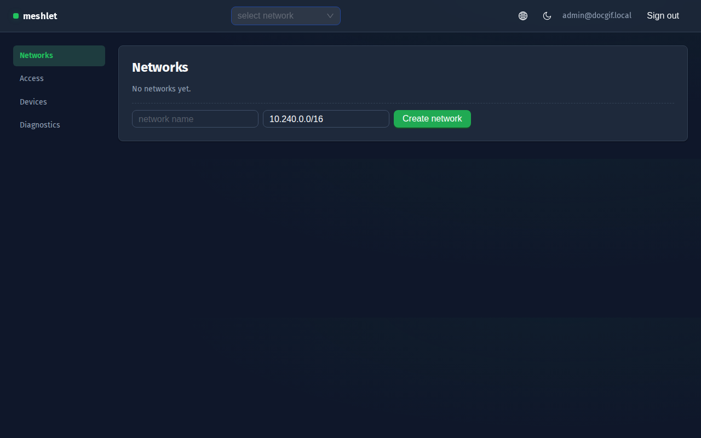
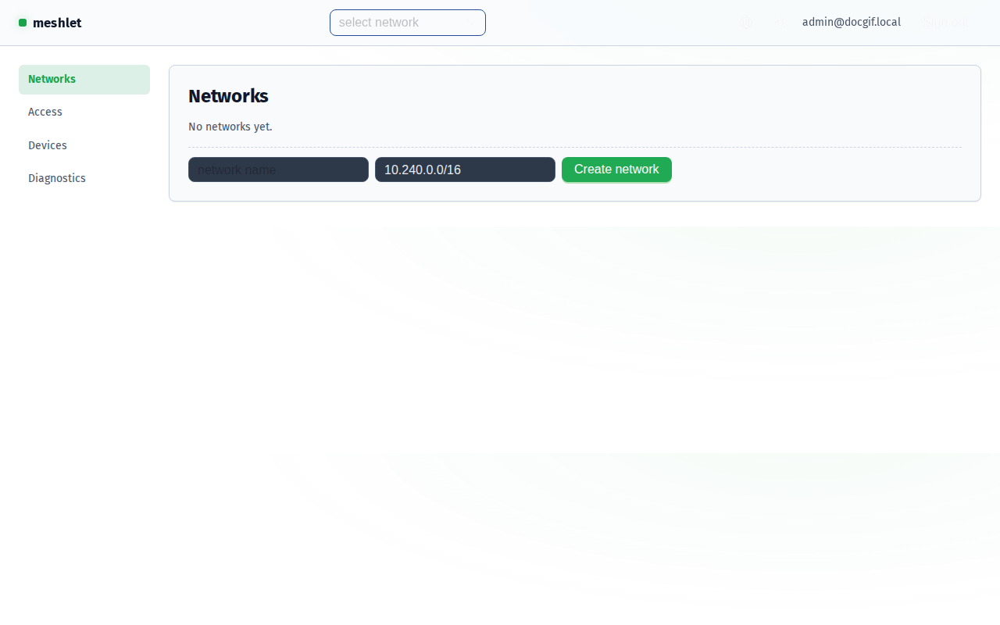
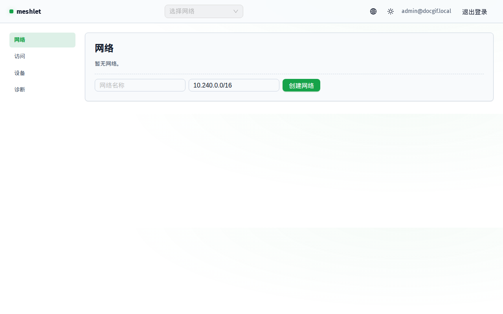
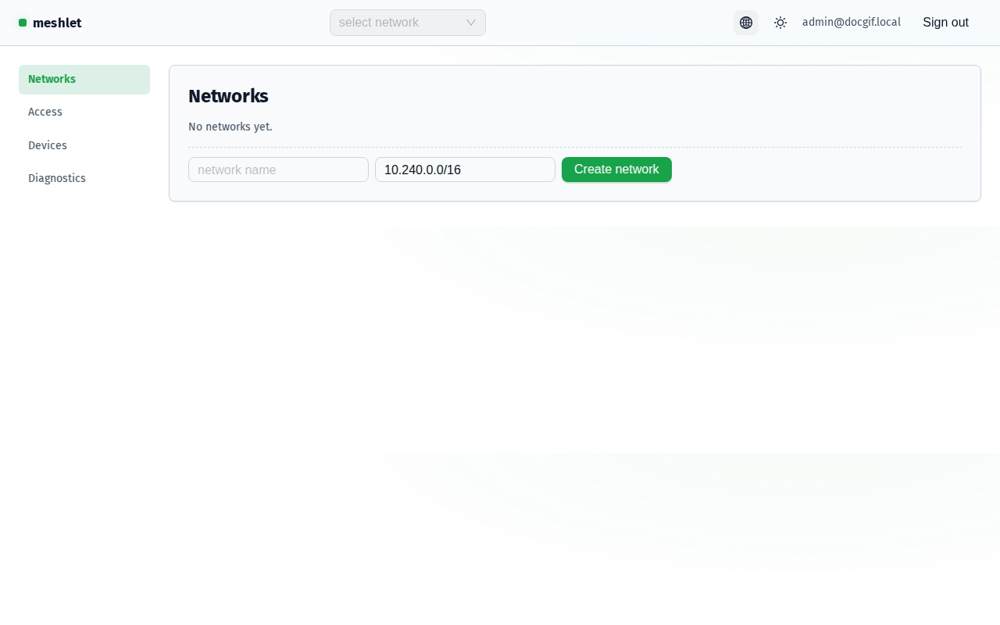
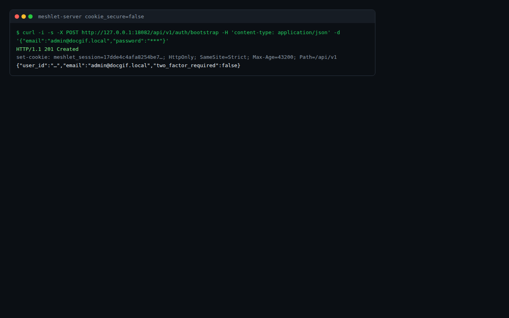
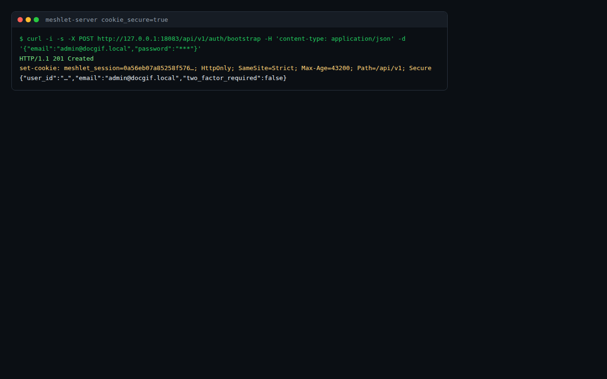
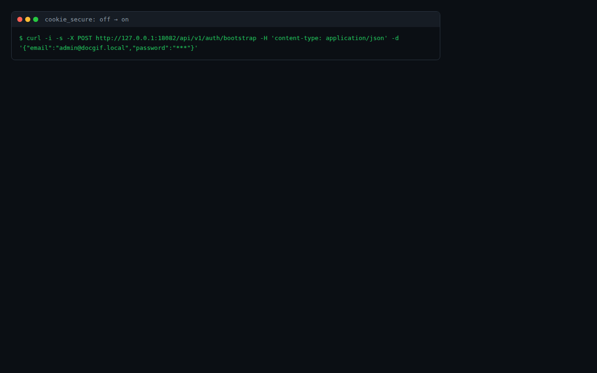
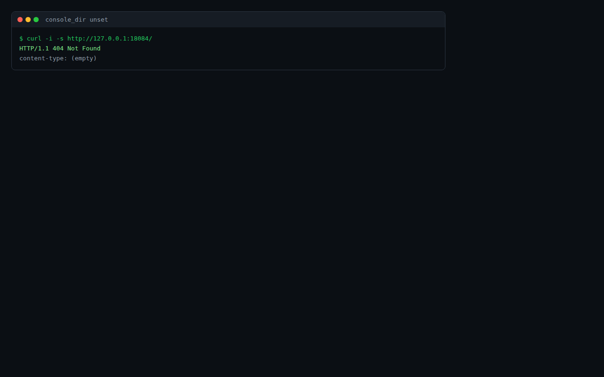
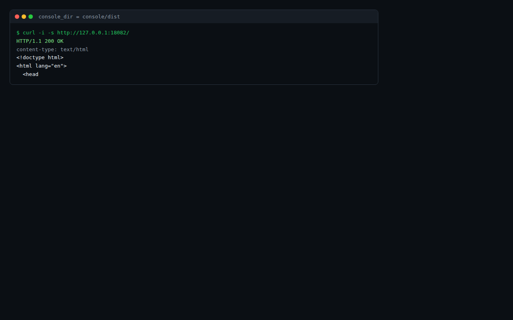
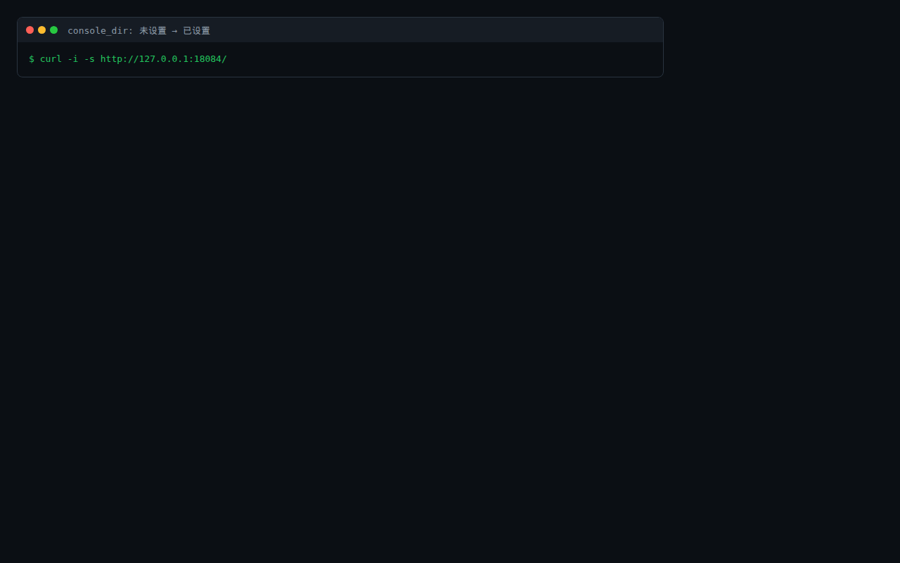

# Configuration Toggle Effects

Every toggle in Meshlet that has a visible on/off effect, with off/on screenshots and an animated GIF for each. The evidence is generated by a reproducible capture pipeline (`scripts/doc-gif/run.sh`) that drives the real UI and real HTTP output — no hand-drawn diagrams. The same pipeline asserts the effect, so it doubles as a regression test: any check that fails makes the run exit non-zero.

## How the evidence is produced

- GUI toggles are recorded by driving the real console in headless Chromium (Playwright) and capturing frames across the switch.
- Server/CLI toggles record the real HTTP exchange (the exact `Set-Cookie` header or status line) and render it as a terminal capture.
- Frames are composited into GIFs with `ffmpeg` (palettegen/paletteuse).
- Re-run any time: `scripts/doc-gif/run.sh` (builds the console and server, boots throwaway instances on loopback, captures, asserts, and writes to `docs/public/toggles/`).

## Console theme (dark ↔ light)

The console follows the OS color scheme until you pick a theme explicitly. The choice is stored in `localStorage['meshlet-theme']` (`console/src/theme/theme-provider.tsx`). Off = dark (the default), on = light.

| Off (dark) | On (light) |
| --- | --- |
|  |  |

## Console language (English ↔ 中文)

The console follows the browser language (`zh*` → 中文, otherwise English) until changed. The choice is stored in `localStorage['meshlet-lang']` (`console/src/i18n/language-provider.tsx`). Off = English, on = 中文.

| Off (English) | On (中文) |
| --- | --- |
|  |  |

## Server `cookie_secure`

`cookie_secure = true` in the server config adds the `Secure` attribute to the session cookie (`apps/server/src/auth.rs`). Off = no `Secure` attribute (HTTP-friendly), on = `Secure` (browser only sends it over HTTPS). The captures below are the real `Set-Cookie` header from a bootstrap request.

| Off (cookie_secure = false) | On (cookie_secure = true) |
| --- | --- |
|  |  |

## Server `console_dir`

When `console_dir` is set, the server hosts the built console at `/`; when unset, `/` is a 404. Off = unset (404), on = set (serves the console bundle).

| Off (console_dir unset) | On (console_dir set) |
| --- | --- |
|  |  |

## Toggles not recorded on this host

These switches exist but their effect requires a host this pipeline cannot drive, so they are **not** in the GIF list above (the pipeline would produce a misleading or impossible capture). Each is recorded honestly where it can be:

- Tray app: autostart / animations / language — a desktop Tauri window (system tray). Needs a Windows or macOS GUI session; on this Linux host the tray app has no display. Record by running the tray app on a desktop host and capturing its settings window (`apps/tray-app`).
- Agent `[dataplane] enabled` — the effect is the agent actually applying WireGuard config to a real interface (needs `NET_ADMIN` and a reachable hub). Record with `MESHLET_REQUIRE_DATAPLANE=1` and a data-plane-capable host (see ADR-007).
- Agent `[dataplane.direct_connect] enabled`. P2P direct peers need a real second meshlet node. See the R-DIAG-2 acceptance note; the same 2-node scenario is a prerequisite.
- Service notifications / `status_notifier_item` — desktop tray indicator, same host limitation as the tray app.

None of these are faked: they are listed here as not-yet-recordable on this machine rather than shown as passing.

## Reproducibility

`scripts/doc-gif/run.sh` is the single entry point. It builds the console and server, boots isolated loopback instances, drives the captures, asserts the effects, and writes the images. Because every check must pass for the script to exit 0, configuration changes that break an effect surface as a failing run — this page doubles as the configuration-effect regression test.
