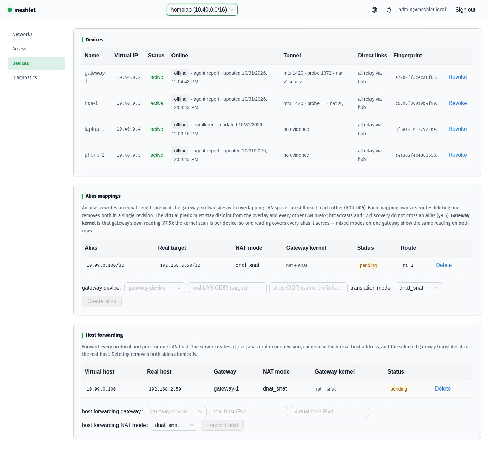
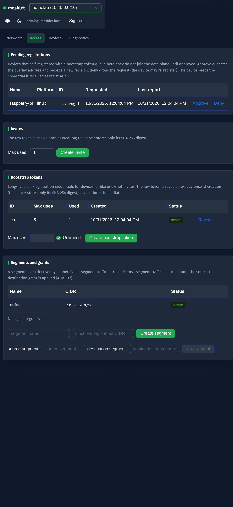
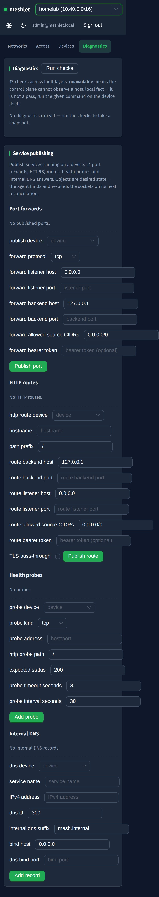
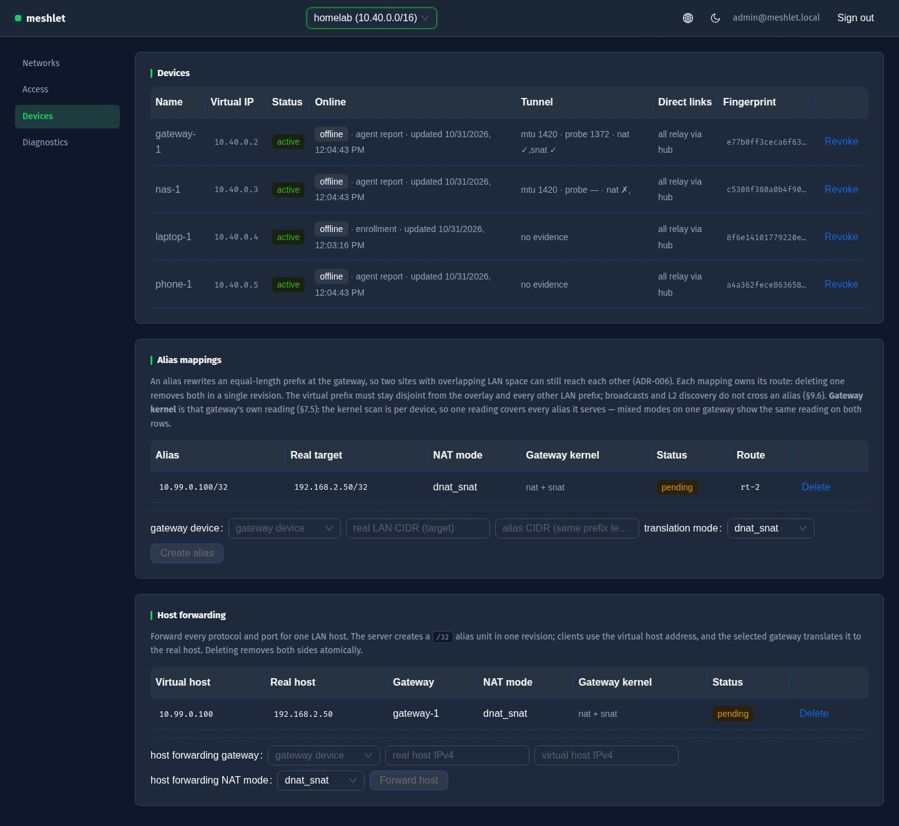

# Console UI Audit · 2026-10-31

Post-redesign verification of the meshlet console. The console was rebuilt on
antd v6 with i18n, a switchable dark/light theme, and a full-width responsive
layout (see `plans/jolly-roaming-pancake.md`). An ml-review pass then audited
the result against WCAG 2.x contrast and narrow-screen behavior; the fixes it
drove landed as commit `30d530c` (`fix(console): aa status colors, focus ring,
table scroll`).

> Provenance: the audit session captured the 13 post-fix screenshots below, then
> was interrupted (API error) before writing the report. This page is the
> completed record, reconstructed from the screenshots and the landed fix
> commit. Findings below are exactly the defects fixed in `30d530c`; the
> screenshots are the evidence of the corrected state. The Windows firewall
> wiring landed the same day (`514cb51`) is a backend change, not UI, and is
> out of scope here.

## Findings

### 1. Semantic status colors failed WCAG AA on light backgrounds

antd's default `success` text (`#52c41a`) and `warning` text (`#d48806`) render
on pale fills at ~2.2:1 and ~2.8:1 — below the 4.5:1 AA requirement for body
text, so status tags (`active`, `pending`, `Hub: pending`) were hard to read on
the light theme.

**Fix (`30d530c`, `console/src/theme/antd-theme.ts`):** pin AA-compliant text +
fill pairs in the light theme — `colorSuccess: #15803d` on `colorSuccessBg:
#f0fdf4` (4.79:1) and `colorWarning: #b45309` on `colorWarningBg: #fffbeb`
(4.84:1). antd derives the fill as a tint of the seed color, so both must be
set together. The dark theme already measured ~9.2:1 / ~9.6:1 and is untouched,
as is the brand primary.

**Evidence:** `light-devices-desktop.jpg` (green `active`, amber `pending`),
`light-networks-desktop.jpg` (green `active`).

### 2. Focus-visible ring was near-invisible

antd's cssinjs styles are injected after `App.css`, so antd's own `:focus-visible`
ring (drawn in `colorPrimaryBg` — `#18492a` on dark, pale green on light) beat
the app rule and was nearly invisible against both surfaces, failing WCAG 2.4.7
/ 2.4.11.

**Fix (`30d530c`, `console/src/App.css`):** `:focus-visible { outline: 2px solid
var(--accent) !important; }` — `!important` wins over antd's injected styles;
the ring stays part of the design and is never removed.

**Evidence:** `dark-diagnostics-narrow.jpg`, `dark-access-narrow.jpg` (accent
outline on focused inputs and buttons).

### 3. Wide tables squeezed on narrow screens

antd squeezes table columns at ~390px and wraps cell text into tall, unreadable
stacks, so the diagnostics and devices tables collapsed instead of scrolling.

**Fix (`30d530c`, `console/src/App.css`):** `.ant-table-content { overflow-x:
auto; }` with `.ant-table-content > table { min-width: max-content; }` — each
table keeps its natural width and the content wrapper scrolls it horizontally,
never squeezing columns.

**Evidence:** `dark-devices-narrow.jpg`, `dark-diagnostics-narrow.jpg`,
`dark-access-narrow.jpg`.

### 4. Devices page did not tolerate an older server omitting `direct_links`

A pre-`direct_links` server omits the field instead of returning `[]`, which
would render an undefined cell in the Direct links column.

**Fix (`30d530c`, `console/src/pages/devices/DevicesSection.tsx`):**
`const links = d.direct_links ?? []` — version-skew tolerance; the column then
renders "all relay via hub" or the link tags as appropriate.

**Evidence:** `dark-devices-desktop.jpg`, `light-devices-desktop.jpg` (Direct
links column renders with the `all relay via hub` label and link tags).

## Post-redesign verification (no defect)

The same pass confirmed the redesigned console holds up across themes and
breakpoints — the fixes above are the only defects it surfaced:

- **Full-width fluid layout**: the shell spans the viewport (no 1140px centered
  squeeze); content reflows at 720 / 1024 / 1280 / 1600px.
- **Narrow responsive stacking**: side nav becomes a horizontal strip and
  panels stack single-column.
- **antd components**: `Select` comboboxes, vertical `Form` with labels,
  `Table` with `Config revisions` pagination, `Button` variants, and `Tag`
  status badges replace the hand-rolled controls.
- **Theme switch**: dark and light render consistently; the dark theme keeps
  the navy `#0F172A` / green `#22C55E` palette.

## Screenshot inventory

| File | Page / theme / viewport | Evidences |
|------|------------------------|-----------|
| `dark-access-desktop.jpg` | Access, dark, desktop | full-width layout, tables, form alignment |
| `dark-access-narrow.jpg` | Access, dark, narrow | responsive stacking, focus ring, table scroll |
| `dark-access-staging-empty.jpg` | Access, dark, empty | empty-state rendering |
| `dark-devices-desktop.jpg` | Devices, dark, desktop | table, `Direct links` fallback, full-width |
| `dark-devices-narrow.jpg` | Devices, dark, narrow | table scroll instead of squeeze |
| `dark-devices-office-empty.jpg` | Devices, dark, empty | empty-state rendering |
| `dark-diagnostics-desktop.jpg` | Diagnostics, dark, desktop | form alignment, buttons |
| `dark-diagnostics-narrow.jpg` | Diagnostics, dark, narrow | focus ring, table scroll, stacked panels |
| `dark-networks-desktop.jpg` | Networks, dark, desktop | networks table, full-width |
| `dark-networks-homelab-detail.jpg` | Networks detail, dark, desktop | revision pagination, status tags |
| `light-devices-desktop.jpg` | Devices, light, desktop | AA success/warning tags |
| `light-networks-desktop.jpg` | Networks, light, desktop | AA active tags, light theme |
| `login-dark-desktop.jpg` | Sign in, dark, desktop | antd form, labeled inputs, primary button |

All screenshots are stored under
`2026-10-31-ui-audit-impeccable/shots/` next to this page.
