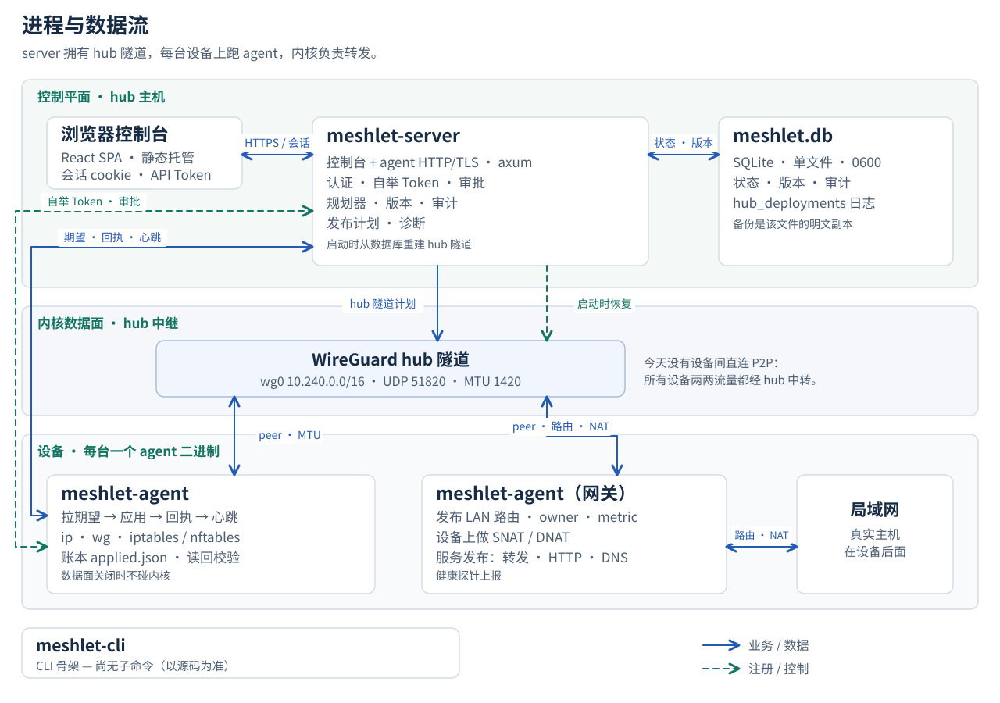

# 进程拓扑

<picture>
  <source media="(max-width: 767px)" srcset="../../public/architecture/system-zh-mobile.svg">
  
</picture>

实线表示业务数据：控制台流量、期望计划与回执、hub 隧道计划、内核变更。虚线表示注册与恢复。

## 三个分区，四个二进制

**控制平面，跑在 hub 主机上。** `meshlet-server` 提供控制台与 agent 的 HTTP/TLS API，负责认证、自举 Token、审批、规划器、版本与审计。全部状态落进一个 `meshlet.db` SQLite 文件（0600，单文件）。server 进程自己也持有 hub 的 `wg0`，并在启动时从数据库重建这条隧道。

**内核数据面。** `10.240.0.0/16` WireGuard overlay，UDP 51820，MTU 1420。今天没有设备间直连 P2P：所有设备两两流量都经 hub 中转。

**设备。** 每台一个 `meshlet-agent` 二进制。它拉取期望计划，用 `ip`、`wg`、iptables 或 nftables 应用，回传回执与心跳，并保留本地账本（`applied.json`）做漂移读回校验。网关 agent 额外发布 LAN 路由（带 owner 与 metric）、在设备上做 SNAT/DNAT，并运行服务发布（转发、HTTP、DNS）。

**`meshlet-cli`** 目前只是骨架，尚无子命令。

## 以源码为准

这张图跟随当前代码，不跟随早前的文档。两处文档与源码不一致：`apps/agent/src/server.rs` 是调用 hub API 的客户端，不是本地监听服务；hub 的 `wg0` 在 server 进程里（`hub_public_key`、`hub_backend_factory`、`hub_deployments`），不在 agent 里。文档与源码冲突时以源码为准。

SVG 变体

- [`system-zh.svg`](./system-zh.svg) — 1280 × 900，桌面
- [`system-zh-mobile.svg`](./system-zh-mobile.svg) — 480 × 1480，竖排改版，不是等比缩小

