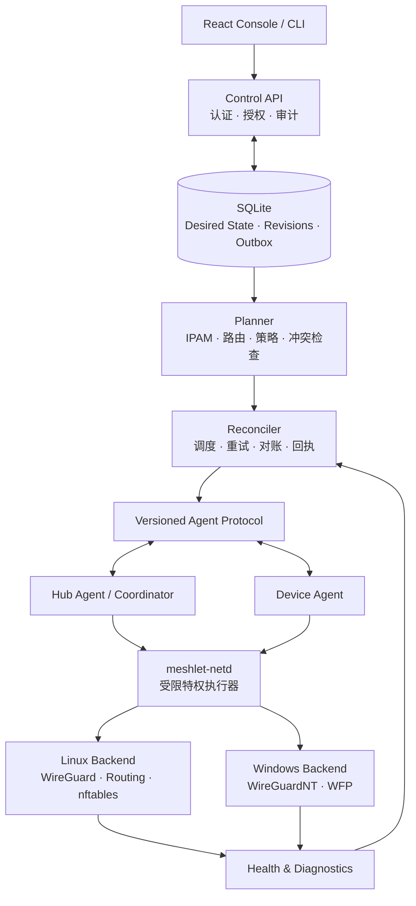

# 目标架构（草案）

简体中文 | English
> 性质：ChatGPT 分享页重构计划评审转录（2026-10-20，用户链接 t_6ad791db...，用户令：作为新实现基线）。
> 约束：本文件是 Meshlet 重构的目标设计与实施顺序来源；TODO.md 据此重写，旧 TODO 已归档不作为前提。

我会按**目标态架构（Greenfield Target Architecture）**来设计 Meshlet：不考虑旧 API、旧数据库结构、旧配置文件和现有模块的兼容性。必要时可以重做数据模型、协议、数据库迁移体系和网络执行后端。

设计原则是：**先确定正确的领域模型、安全语义和状态一致性，再决定代码如何组织；不以保留现有实现为理由妥协。**

结合仓库最新的 `TODO.md`，我会把设计目标确定为个人自托管网络基础设施：设备组网、多个网络与信任分组、远端 LAN 接入、重叠网段、TCP/UDP 端口转发、HTTP 服务发布和可靠的网络诊断。

核心决策先明确：

- **控制面与数据面彻底分离**：Rust 控制面负责身份、策略、网络规划和编排；设备 Agent 负责执行；操作系统内核负责实际转发。
- **期望状态是唯一事实来源**：不再让多个数据库状态字段、缓存和内核状态互相争夺权威。
- **纯函数网络规划器 + 声明式执行器**：先计算完整计划、检查冲突和安全策略，再由执行器应用差异。
- **默认拒绝，而非默认互信**：网络、Segment、设备、服务入口和转发规则都必须具有明确的授权语义。
- **可恢复优先于功能数量**：部分失败、掉线、重启、升级和配置撤销，都必须有可验证的收敛机制。
- **统一资源模型，但分离执行后端**：Overlay、LAN 路由、Alias、端口转发和 HTTP 发布共享身份、策略和状态管理，不共享一套模糊的 NAT 逻辑。

下面给出我建议的完整目标设计。

## 一、目标架构：模块化单体控制面 + 独立特权执行器

我不建议把 Meshlet 拆成微服务，但我建议把**管理权限、网络规划、状态协调、操作系统执行**划分为清晰且强制的边界。



### 1. 每个进程应该负责什么

| 组件 | 唯一职责 | 不应该做什么 |
|---|---|---|
| `meshlet-server` | 管理 API、身份、数据库、审计、编排 | 直接执行任意 Shell 命令 |
| `meshlet-planner` | 把目标配置编译成确定性的执行计划 | 修改内核、访问数据库 |
| `meshlet-reconciler` | 调度执行、追踪结果、修复漂移 | 自己实现 IP 路由算法 |
| `meshlet-agent` | 设备身份、获取计划、协调本地执行、上报回执 | 直接信任远端任意指令 |
| `meshlet-netd` | 在本机执行受限的特权网络操作 | 提供任意命令执行接口 |
| Linux/Windows Backend | 把类型化计划映射到 OS 网络机制 | 维护自己的另一套业务状态 |
| Console / CLI | 操作资源、显示状态、诊断问题 | 自行推导或伪造生效状态 |

这里我特别建议新增 `meshlet-netd`。

当前仓库已经开始通过专用服务用户和 Linux capabilities 限制权限，但目标设计可以进一步将 Web 管理面与网络管理权限分离。

`meshlet-netd` 使用本机 Unix Domain Socket 与服务进程通信，验证调用方身份和请求类型，只接受明确的操作，例如：

- 应用某个已验证的 HubPlan。
- 删除指定的受管 Peer。
- 对账某个受管路由集合。
- 原子替换某个受管防火墙规则集。
- 读取实际内核状态。
- 回滚到经过验证的安全配置。

它绝不提供 `exec(command)` 这种通用接口。

Windows 采用对应的受保护 Windows Service，而不是让桌面控制台直接获得管理员权限。

**我的建议是从一开始就建立这个安全边界，不要等到将来出现安全问题再拆。**

---

## 二、先重新设计领域模型

我认为 Meshlet 最容易继续复杂化的地方，是把网络、信任组、路由、Alias、端口转发和 HTTP 服务发布都视作不同类型的“网络配置”。

这些对象之间有关联，但它们不是同一类资源。

### 2.1 统一领域模型

**Network · 虚拟网络**

一个独立的 WireGuard 网络、地址空间、网络级策略与配置修订域。

**Segment · 信任分组**

定义哪些设备属于同一信任域，以及跨组通信的许可。

**NetworkAttachment · 设备入网关系**

设备加入哪个网络、分配什么地址、属于哪个 Segment、承担什么网关角色。

**RouteAdvertisement · 网段发布**

某个网关发布哪个真实 LAN 前缀，如何选择路径，以及返回流量如何路由。

**PrefixTranslation · 地址映射**

通过 Alias 前缀解决不同 LAN 的地址冲突，明确原始目标、映射目标和适用范围。

**Service / Exposure · 服务与发布入口**

描述目标服务、监听地址、协议、端口、HTTP 域名与路径，以及谁有权访问。

**Policy · 统一授权模型**

控制设备、Segment、远端 LAN 和发布服务之间的实际访问权限。

### 2.2 必须区分的五种资源

| 资源 | 解决的问题 | 不应该承担的职责 |
|---|---|---|
| Network | 哪个虚拟网络？ | 不直接表示某个服务端口 |
| Segment | 哪些设备彼此信任？ | 不负责路由网关的选择 |
| Route | 哪个目标网段走哪个网关？ | 不代表用户获得了访问授权 |
| Prefix Translation | 重叠地址如何区分？ | 不替代访问控制 |
| Service Exposure | 哪个入口映射到哪个服务？ | 不等同于打通整个目标网段 |

这是一个关键的架构决策。

例如，假设你有两台 NAS、两台 VPS，以及两个都使用 `192.168.1.0/24` 的远端 LAN。

正确的模型应该是：

- 两个不同的网关，各自发布一个真实 LAN 前缀。
- 两个独立的 Alias 前缀，分别映射到对应的真实 LAN。
- 两个独立的路由目标。
- 两套可以不同的访问策略。
- 每个目标服务可以单独设置端口暴露规则。

不能仅靠增加一条 `Route` 或 `Alias` 记录，就隐式地完成所有事情。

### 2.3 Device 和 NetworkAttachment 必须分离

我建议把设备身份与设备入网关系分开。

- `Device`：代表一台安装了 Meshlet Agent 的物理或虚拟设备，拥有独立身份。
- `NetworkAttachment`：代表这台设备在某个 Network 中的参与关系。
- `DeviceCredential`：设备认证凭证。
- `DeviceAddressAssignment`：该设备在特定网络中的地址分配。
- `DeviceCapability`：设备实际支持的执行能力，例如 IPv4、IPv6、LAN 路由或特定防火墙功能。

这样，即使将来实现一台机器加入多个 Network，也不必把它复制成多个互不相关的设备。

每个 Attachment 独立拥有网络地址、Segment、网关角色和应用状态。某台设备在一个网络被撤销，不应自动导致它在另一个网络被撤销。

当前仓库将一机多网列为暂缓能力；我建议现在就采用这种数据模型，但可以把一机多网的完整执行能力安排到后续阶段。

---

## 三、期望状态必须成为唯一事实来源

这是整个系统最重要的设计。

我建议将系统中的状态分成四类，不允许它们互相混用。

**1. Desired State：期望状态**

用户希望网络变成什么样。保存在数据库中，是系统的业务事实来源。

**2. Revision / Plan：不可变配置修订与执行计划**

某一代期望状态对应的快照、哈希、执行目标和操作依赖关系。

**3. Observed State：实际观察状态**

从 WireGuard、操作系统路由、防火墙和 Agent 读取的真实运行情况。

**4. Health State：健康状态**

实际流量是否可达，目标 TCP/UDP 服务是否可用，HTTP 服务是否健康。

### 3.1 一次配置修改应该怎样运行

假设用户创建了一个新的 LAN 路由。

读取当前网络期望状态，构造修改后的候选状态。
运行地址冲突检查、网关选择检查和授权检查。
将候选状态编译成确定性的网络计划，确保规划成功。
通过事务提交资源变更、不可变修订快照、审计记录和待执行任务。
后台 Reconciler 调用 Hub 和对应设备的执行器。
执行器逐项应用计划，读取实际状态并进行核验。
各目标返回带有修订号和计划哈希的应用回执。
系统独立验证端到端连接和业务健康状态。

数据库提交成功只意味着新的期望状态已经保存，不能意味着网络已经生效。

仓库目前已经实现修订状态、设备回执以及拒绝过期回执的机制；目标设计应该保留这些原则，并进一步统一成正式的状态模型。

### 3.2 修订状态不要再使用一个简单的 `Applied`

建议每个 Revision 都拥有独立的执行记录：

| 状态 | 含义 |
|---|---|
| `Pending` | 已提交，等待执行 |
| `Preparing` | 正在检查目标和准备变更 |
| `Applying` | 至少有一个目标正在应用 |
| `PartiallyApplied` | 部分目标成功，部分目标仍未收敛 |
| `Converged` | 所有必需目标均已达到对应的期望状态 |
| `Failed` | 本次执行失败，当前期望状态仍然存在 |
| `Superseded` | 已有更新的期望修订取代它 |

业务健康状态另行记录，例如 `Healthy`、`Degraded`、`Unreachable`、`NotProbed`。

这样，即使所有设备都已安装配置，但目标 NAS 已经宕机，Meshlet 仍然可以准确表达“网络配置已收敛，业务不可用”。

### 3.3 回滚必须创建新的修订

不建议直接修改历史 Revision，也不建议在执行失败后偷偷把数据库状态改回旧值。

假设：

- R1：当前正常运行。
- R2：用户新增一条路由。
- R2 应用失败。
- 系统恢复到上一次安全运行状态。

此时 R2 仍然是一次真实发生过的失败变更。如果用户决定撤销该变更，应创建 R3，其期望状态恢复为 R1 对应的业务配置。

同时要加入一个重要的安全规则：

**回滚不能恢复已经明确撤销的权限、设备凭证或授权关系。**

例如，设备已经被撤销，就算 last-good 快照中还存在它，也绝不能因为恢复旧计划而重新开放访问。

---

## 四、Planner：把所有网络规划集中到一个纯逻辑模块

我建议建立一个独立的 `meshlet-planner`，它不访问数据库、不运行系统命令，也不持有任何私钥。

输入是一个不可变的 Network Snapshot，以及相关的设备能力和安全策略。

输出是一个确定性的 Plan。

```text
Desired Network Snapshot
          |
          v
     Schema Validation
          |
          v
      IPAM / CIDR
          |
          v
    Conflict Analysis
          |
          v
   Route Computation
          |
          v
   Policy Compilation
          |
          v
   Service Compilation
          |
          v
     Device Plans
     Hub Plan
          |
          v
    Plan Hash / Diff
```

### 4.1 Planner 必须负责的工作

- Overlay 地址分配与地址冲突检查。
- 所有 LAN 路由的目标前缀、网关和优先级计算。
- 重叠网段 Alias 的转换规则。
- Segment 授权和跨网访问策略。
- TCP/UDP 端口转发规则。
- HTTP 域名、路径和上游目标规则。
- 根据设备平台和能力决定哪些操作可执行。
- 为每个设备生成独立计划。
- 生成 Hub 所需的全局 Peer、路由和防火墙计划。
- 对每一份计划进行规范化序列化并计算哈希。

### 4.2 冲突检查必须是全局且与创建顺序无关的

这是当前设计需要重点强化的地方。现有 TODO 已经指出 Overlay、Alias、Direct 和共享转发前缀之间仍有更完整的冲突检查工作。

我建议建立统一的冲突分析器，而不是继续在每个 CRUD Handler 中编写一套独立判断。

冲突分析至少需要考虑：

- 同一个 Network 内的 Overlay CIDR。
- Segment 与 Overlay 的包含关系。
- 不同网关发布的 LAN 前缀。
- 不同 Alias 的映射目标。
- Direct 路由与 Alias 路由的交集。
- 同一设备实际连接的本地 LAN。
- 主机已有的路由和监听端口。
- 同一监听地址、协议和端口被多个服务占用。
- 多个网关发布相同目标时的选择和故障切换规则。

冲突结果应该是类型化错误，例如：

- `OverlayOverlap`
- `AliasPrefixConflict`
- `AmbiguousGateway`
- `LocalRouteConflict`
- `ListenerConflict`
- `UnsupportedBackendCapability`

不能依赖字符串错误消息做业务判断。

### 4.3 路由选择必须确定性

如果两个网关都发布 `192.168.10.0/24`，系统不能随意挑一个。

目标模型应该明确包含：

- 路由所有者。
- 目标前缀。
- 网关。
- 路由优先级。
- 健康检查条件。
- 故障切换策略。
- 返回路径模式。
- Alias 映射关系。
- 所属 Network 和可见的 Segment。

默认拒绝歧义；只有用户显式配置优先级或明确的冗余路由策略时，才允许多网关竞争同一个目标。

---

## 五、安全模型：从网络互通转向明确授权

我建议将安全设计分成三个不同层次。

### 5.1 第一层：设备身份与入网审批

设备首次注册：

1. 用户生成一次性 Bootstrap Token。
2. Token 只保存摘要，设置有效期和使用次数。
3. Agent 使用 HTTPS 注册并提交自己的公钥。
4. 服务端创建待审批设备。
5. 用户批准设备，服务端建立独立设备身份和长期凭证。
6. 后续通信使用设备身份认证，并支持凭证轮换与撤销。

目标方案建议使用 HTTPS + 设备级 mTLS 身份。初始注册 Token 只用于建立身份，不应作为设备长期通行证。

服务器和 Agent 的私钥均不应进入公共配置快照、普通 API 响应或日志。备份流程也必须明确区分业务数据库与设备密钥。

### 5.2 第二层：Segment 与访问策略

建议保留 Network 内的 Segment，但正式采用以下授权契约：

- 新建 Network 时创建默认 Segment。
- 默认 Segment 可采用明确的“可信组”策略模板。
- 自定义 Segment 默认不允许跨段主动访问。
- 跨 Segment 授权必须明确方向。
- 授权应支持协议、端口、来源与目标限制。
- 授权撤销必须及时阻断新的未授权流量。
- 设备被撤销时，Hub 必须拒绝其流量，不能依赖客户端主动更新。
- 已存在的连接必须按明确的撤销语义处理。

这里我建议保留同段可信的便捷模式，但它应该是明确的策略配置，而不是内核里隐含的永久 `ACCEPT`。

### 5.3 第三层：执行层真正实施策略

WireGuard `AllowedIPs` 可以限制路由和 Peer 地址归属，但不能单独作为完整的应用访问控制。

因此：

- Linux Hub 使用独立的受管 nftables 规则集。
- 每个 Network 的转发路径都有明确的身份与策略归属。
- 跨段流量经过状态防火墙检查。
- 服务入口执行单独的目标和端口授权。
- 设备本地也可以根据需要执行主机级防火墙策略。
- Windows 使用 Windows Filtering Platform 等真正的防火墙机制，而不是仅通过路由配置假设访问已被限制。

仓库的 Segment 设计文档已经明确要求设备侧路由可见性与 Hub 防火墙同时执行授权。

### 5.4 Linux 网络执行后端怎么选

目标方案建议：

| 能力 | 方案 |
|---|---|
| WireGuard | Linux 内核 WireGuard |
| 接口与路由 | `iproute2`，使用严格参数化调用 |
| 防火墙 | nftables，使用独立受管规则集和原子更新 |
| NAT | 明确类型化的 DNAT、SNAT、NETMAP 规则 |
| 状态读取 | 通过实际内核查询，而不是只读本地账本 |
| 执行权限 | `meshlet-netd` 的受限操作接口 |

我不建议一开始就为所有 Linux 网络操作重写底层 Netlink 实现。最重要的是执行结果可验证、规则可原子更新、资源所有权明确，以及故障后可以恢复。nftables 适合作为新架构的防火墙目标，但这不意味着每一项功能都必须立刻改写成低层协议实现。

---

## 六、LAN、Alias、端口转发与 HTTP 服务必须使用不同的执行引擎

这是我最希望你在目标架构中坚持的一条原则。

### 6.1 LAN 路由引擎

职责：让 Overlay 设备访问远端 LAN。

负责：

- 路由发布与撤销。
- 网关选择。
- Direct 路由。
- 返回路径。
- 必要的 SNAT。
- 网关健康和故障切换。
- 重叠网段的可见性和冲突检查。

### 6.2 Alias 映射引擎

职责：解决重叠地址空间的问题。

例如：

- 本地 LAN：`192.168.1.0/24`
- 远端站点 A：`192.168.1.0/24`
- 远端站点 B：`192.168.1.0/24`

用户通过两个不同的虚拟 Alias 前缀访问 A 和 B。系统需要将目标地址转换到正确的真实前缀，并保证回程流量仍然属于正确的映射。

Alias 不能只是一个 UI 标签。它必须有清晰的映射方向、地址范围、网关、返回模式、适用策略以及删除清理语义。

### 6.3 L4 服务发布引擎

职责：把一个明确的 TCP 或 UDP 入口映射到目标服务，而不是打通整个网段。

建议独立定义 `PortForward`：

```text
PortForward {
    id,
    network_id,
    listener_address,
    protocol,
    external_port,
    backend_device_id,
    backend_address,
    backend_port,
    access_policy_id,
    enabled
}
```

这是概念结构，不是最终序列化格式。

需要特别区分：

- 入口监听端口。
- 上游服务端口。
- TCP 与 UDP。
- 目标是否为本机服务。
- 目标是否为远端 Overlay 设备。
- 目标是否为远端 LAN。
- 是否需要 DNAT、SNAT 或返回路由。
- 服务撤销时应该清理哪些规则。

### 6.4 HTTP 服务发布引擎

职责：基于域名和 URL 路径将 HTTP/HTTPS 请求转发到具体服务。

例如：

- `nas.example.com` → NAS Web UI。
- `git.example.com` → Git 服务。
- `example.com/api/` → 指定 API 服务。
- `example.com/admin/` → 另一个受保护的服务。

HTTP 发布不应该被实现成大量零散的 iptables 规则。

我建议引入独立的 `ServicePublisher` 接口，负责：

1. 校验域名、路径、上游地址和授权。
2. 生成完整的目标配置。
3. 验证配置有效性。
4. 原子更新或安全重载。
5. 验证上游连通性。
6. 失败时保留上一份有效配置。
7. 将配置状态与业务健康状态分开上报。

对于 HTTP/HTTPS，优先评估使用受 Meshlet 管理的 Caddy 实例作为反向代理后端，以利用成熟的 TLS 和配置校验能力；如果最终选择 Nginx，也应该保持相同的 `ServicePublisher` 抽象。不能直接覆盖用户已有的 Nginx/Caddy 配置。

### 6.5 DNS 与服务目录

DNS 应当是一个独立功能，而不是顺手修改所有设备的系统 DNS。

建议：

- 提供可配置的内部域名。
- 默认只解析 Meshlet 管理的服务。
- 支持分流 DNS，而不覆盖设备原有的公共 DNS 配置。
- 服务删除时同步删除相应记录。
- DNS 解析结果遵循 Network、Segment 和服务可见性策略。
- 服务目录显示服务地址、目标设备、健康状态和授权要求。

---

## 七、Rust 工作区：建议重建为明确的 crate 边界

不需要微服务，但需要真正的模块化。

我建议的目标目录如下：

```text
meshlet/
├── apps/
│   ├── server/                 # Control API and orchestration
│   ├── agent/                  # Device-side coordinator
│   ├── netd/                   # Privileged host network executor
│   └── cli/                    # Administration and diagnostics
├── crates/
│   ├── meshlet-domain/         # Pure domain model
│   ├── meshlet-ipam/           # Address allocation and CIDR
│   ├── meshlet-policy/         # Authorization semantics
│   ├── meshlet-planner/        # Deterministic network compiler
│   ├── meshlet-protocol/       # Versioned Agent protocol
│   ├── meshlet-store/          # Persistence interfaces
│   ├── meshlet-store-sqlite/   # SQLite implementation
│   ├── meshlet-control/        # Application use cases
│   ├── meshlet-reconciler/     # Desired/observed convergence
│   ├── meshlet-net-backend/    # Platform backend contracts
│   ├── meshlet-net-linux/      # WireGuard, routes, nftables
│   ├── meshlet-net-windows/    # WireGuardNT, WFP, routes
│   ├── meshlet-service-l4/     # TCP/UDP forwarding
│   ├── meshlet-service-http/   # HTTP service publication
│   └── meshlet-observability/  # Logs, metrics, diagnostics
├── console/
├── migrations/
├── protocol/
├── docs/
└── scripts/
```

这些模块之间的依赖关系应该是单向的：

- `domain` 不依赖 Axum、SQLite 或操作系统。
- `ipam`、`policy` 和 `planner` 不执行任何副作用。
- `store` 只负责持久化抽象和事务。
- `control` 负责业务用例和事务边界。
- `reconciler` 负责协调和恢复。
- 平台 Backend 只负责执行具体网络操作。
- `server`、`agent`、`netd` 负责进程生命周期和依赖装配。

这与仓库已有的模块化提案方向一致，但这里明确把目标依赖边界作为强约束，而不再以兼容现有 crate 的布局为优先。

---

## 八、持久化和并发：不要使用完整事件溯源，但要保留不可变历史

对 Meshlet 目前的个人自托管定位，我仍然推荐 SQLite，不推荐为了架构完整而提前引入 PostgreSQL、Redis、消息队列和微服务。

目标数据层应该包括：

| 数据类别 | 存储策略 |
|---|---|
| 设备、网络、路由、授权、服务 | 规范化关系表 |
| 当前期望状态 | 可事务更新的资源模型 |
| Revision 快照 | 不可变、可校验 |
| Apply Attempt / Receipt | 可追踪的执行记录 |
| Audit Log | 追加式审计记录 |
| Outbox | 与业务变更同事务提交的任务 |
| 实际内核状态 | 实时读回与可重建观察数据 |
| 私钥和长期凭证 | 独立受保护的本地密钥存储 |

我不建议把每一次操作都做成全量事件溯源。对于这个项目，规范化业务表 + 不可变修订快照 + 审计日志 + Transactional Outbox 更容易维护。

### 并发处理

网络修改应有明确的并发边界：

- 同一个 Network 的变更使用乐观版本检查或网络级串行化。
- 不同 Network 可以并行应用。
- 同一个设备的本地执行应当串行化，避免多个计划互相覆盖。
- 数据库事务提交后再执行外部网络操作。
- 任务写入与业务变更通过 Outbox 保证原子性。
- 任何失败都要有明确的重试、超时、取消和最终状态。

数据库不能在一个长事务中等待内核命令执行，也不能在外部操作成功前就宣称整个业务事务已经完成。

### 备份与恢复

备份应包含：

- 期望状态。
- 网络、设备、授权、路由与服务配置。
- 必要的修订历史与审计记录。
- 设备注册与撤销状态。

私钥应独立保护；如果备份包含密钥，必须是显式选择、加密保护的恢复包。

恢复时不能简单地把 SQLite 数据库恢复完成就宣布服务恢复。必须重新读取期望状态、检查凭证和密钥、编译计划，再对账真实内核状态。仓库现有文档已经指出，仅恢复 SQLite 不会自动恢复 Hub 的内核状态。

---

## 九、Agent 协议与状态一致性

我建议继续使用 HTTPS + JSON 作为初始控制协议，不需要为了现代化而强制引入 gRPC。

但是要统一协议定义：

- 公共管理 API 以 OpenAPI 为契约来源。
- Agent Plan 使用单独的、版本化的 Schema。
- Rust 与 TypeScript 类型尽量由 Schema 生成。
- 所有 Plan 都包含协议版本、修订号、目标 ID、计划哈希和所需能力。
- Agent 只接受自己支持的协议版本与计划类型。
- 版本不兼容时明确拒绝，不允许静默降级。
- 设备回执必须与当前期望修订及计划哈希完全匹配。
- 重试使用幂等标识，不能重复产生不可逆副作用。

这里不保留旧协议兼容，不代表可以不要协议版本。**可以放弃旧版本，但不能让版本边界变得模糊。**

Agent 应使用有抖动的退避重试与长轮询，避免大量设备在服务端重启后同时请求。实时推送可以作为优化，但不能成为唯一的任务传递方式；即使丢失推送，Agent 也必须最终发现新修订。

---

## 十、执行器必须具备可验证的恢复能力

网络变更不是一个普通的 CRUD 操作。它可能修改多个相互依赖的内核资源，无法指望数据库事务帮你回滚所有外部副作用。

我建议所有网络执行计划都具备：

- `Prepare`：校验前置条件与资源所有权。
- `Apply`：按依赖顺序执行操作。
- `Verify`：从内核读回实际状态。
- `Commit`：记录成功计划和实际观察结果。
- `Compensate`：发生失败时执行有界的补偿与恢复。
- `Reconcile`：持续修复期望状态与实际状态的差异。

注意，补偿不等于无条件恢复所有旧规则。安全撤销必须优先于恢复旧状态。

例如，撤销一个设备时，应先阻断该设备在 Hub 的转发权限，再清理其他相关状态。即使某个 Agent 离线，也不能让它继续通过 Hub 访问已经被撤销的目标。

同理，扩展访问权限时，应先准备路由和相关资源，最后开放实际的防火墙授权，避免在应用中途意外扩大权限。

这些执行顺序需要写入 Planner 和执行器的明确契约，而不是依赖各个 Handler 的偶然调用顺序。

---

## 十一、测试体系也应重新设计

我建议将测试分成五层，并为每一层定义独立的通过标准。

| 层级 | 测试内容 | 验收重点 |
|---|---|---|
| L1：纯逻辑 | IPAM、CIDR、冲突分析、策略、计划编译 | 确定性、边界条件、属性测试 |
| L2：存储与 API | 事务、审计、授权、修订、Outbox | 无孤儿资源、并发安全、失败不提交 |
| L3：真实内核 | Linux network namespace、WireGuard、nftables | 真实数据面允许与拒绝 |
| L4：平台集成 | Windows 虚拟机、服务启动、权限、路由与防火墙 | 开机恢复、重启、撤销、升级 |
| L5：部署验收 | 空白 VPS、备份恢复、升级回滚、真实设备 | 端到端可用、故障可恢复 |

仓库已经拥有较多 Linux netns 测试，并明确区分本机测试与真实部署验收。目标设计应保留这一原则，同时补齐 Windows 的真实平台测试和真实 VPS 验收。

我还建议补充以下自动化能力：

- CIDR 冲突检测的属性测试。
- 相同输入始终生成相同 Plan Hash 的测试。
- 随机变更顺序不改变最终计划的测试。
- 对每个执行阶段注入失败，验证最终状态。
- 对所有撤销操作执行负向连通测试。
- 测试删除资源后不存在残留路由、Peer、NAT 或监听器。
- 测试数据库备份、恢复、密钥轮换和凭证撤销。
- 在严格数据面 CI 中，依赖缺失必须失败，不能把跳过当成通过。

测试覆盖率可以作为指标，但不应该成为唯一验收标准。对于网络基础设施，**真实内核中未经授权的流量确实无法通过**，比某个函数是否达到 100% 行覆盖率更重要。

---

## 十二、最终实施顺序

虽然不考虑旧结构兼容性，但我仍然建议按照依赖关系实施，而不是同时重写所有模块。

01

**基础架构重建**

最高优先级

重新定义领域模型、Revision、Plan、Receipt、协议 Schema 和 crate 依赖。建立纯 Planner、SQLite 事务与 Outbox，以及特权执行器接口。

02

**可靠的 Linux 网络基础设施**

重建 WireGuard Hub、Peer 管理、路由、nftables、安全撤销、漂移检测、last-good 恢复和单实例多网络隔离。

03

**统一网络规划与冲突分析**

完成 IPAM、Segment 策略、网关选择、Direct 路由、Alias 映射和全局冲突检查。

04

**完成设备端到端组网**

先让 Linux Agent 完整支持注册、启动恢复、执行回执、重试、升级和真实连接诊断。

05

**Windows 完整客户端**

通过真正的平台后端完成隧道服务、系统路由、防火墙、权限提升、开机恢复和卸载清理。

06

**服务发布**

实现 TCP/UDP 端口转发、HTTP/HTTPS 发布、授权控制、健康探测和内部 DNS 服务目录。

07

**正式部署与长期运行验收**

完成空白 VPS 安装、密钥轮换、备份恢复、升级回滚、性能基线和真实多设备验收。

## 最后的架构决策

如果按照这个方案推进，我建议正式确定以下几条原则，作为 Meshlet 后续所有设计的约束：

1. **模块化单体，而非微服务。**
2. **Desired State + 不可变 Revision + 纯 Planner + Reconciler，是系统的核心。**
3. **控制面不直接拥有通用的特权命令执行能力。**
4. **Network、Segment、Route、Alias、PortForward 和 HTTP Exposure 是不同的领域对象。**
5. **访问控制必须在实际执行层生效，不能只依赖配置界面和 WireGuard AllowedIPs。**
6. **回滚不能重新开放已撤销的权限。**
7. **所有资源变更都必须可验证、可审计、可重试，并且能够从真实内核状态重建。**
8. **SQLite 足以支持当前个人自托管定位，但持久化边界必须允许未来替换。**
9. **Linux 与 Windows 共享领域模型、协议和规划逻辑，执行后端各自实现。**
10. **CI 通过、内核测试通过、真实 VPS 验收通过，是三个不同的完成标准。**

我认为这比在当前结构上继续叠加功能更有价值。Meshlet 真正应该成为的，不是一个“WireGuard 配置管理器”，而是一个**拥有清晰安全模型、声明式网络编排、可靠故障恢复与统一服务发布能力的自托管网络控制系统**。

下一步最合理的交付物，是把这份目标设计固化成 `docs/architecture/target-architecture.md`，同时重新制定领域模型、协议、数据表、执行状态机和验收标准，并据此重写面向 Code Agent 的 `TODO.md`。这应该作为新的实现基线，而不是继续以旧 TODO 中的模块边界作为不可更改的前提。

---

If you want, I can:

- 继续详细描述 Alias 映射引擎设计
- 展开说明 LAN 路由引擎的实施挑战
- 介绍端口转发和 HTTP 服务执行引擎设计要点
