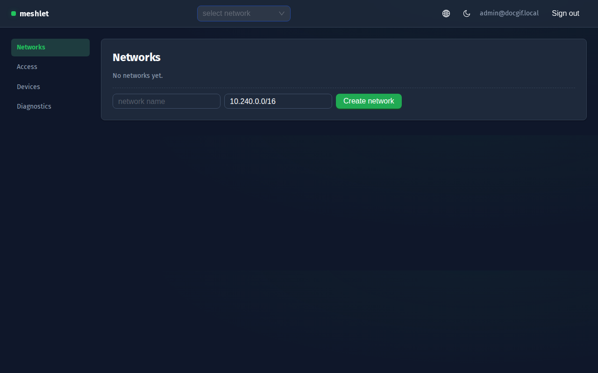
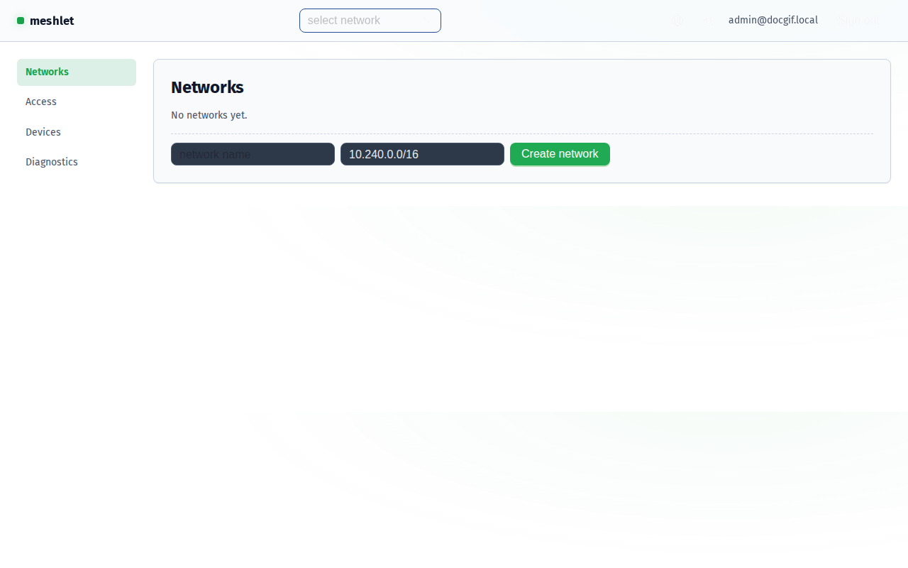
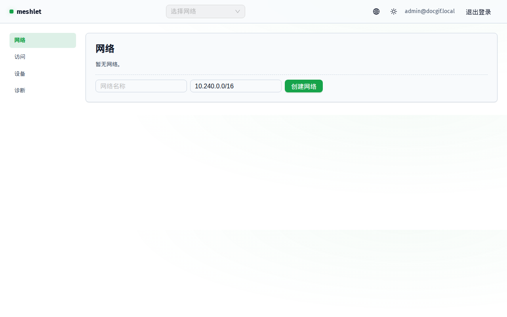
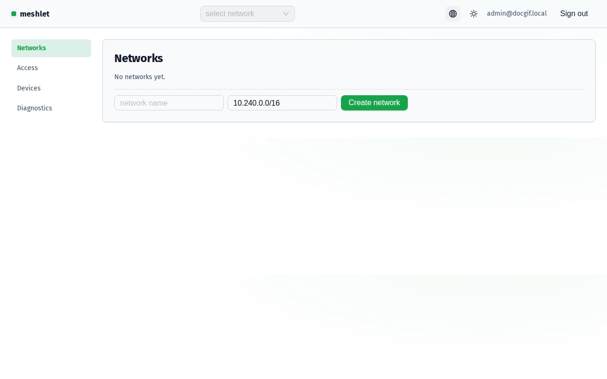
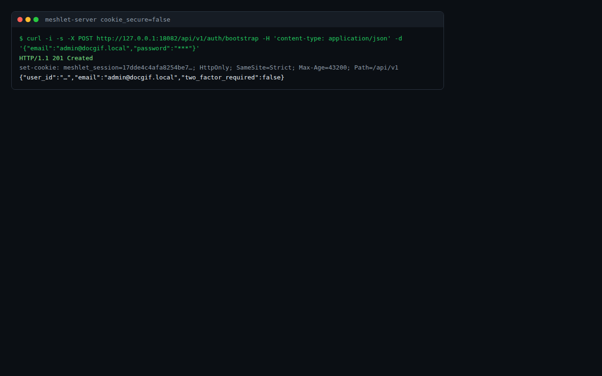
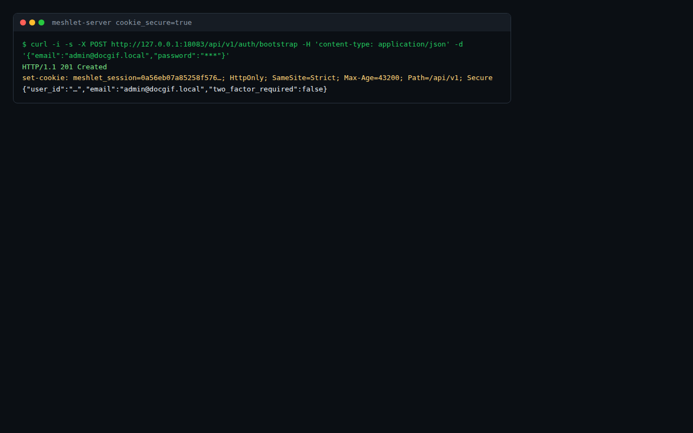
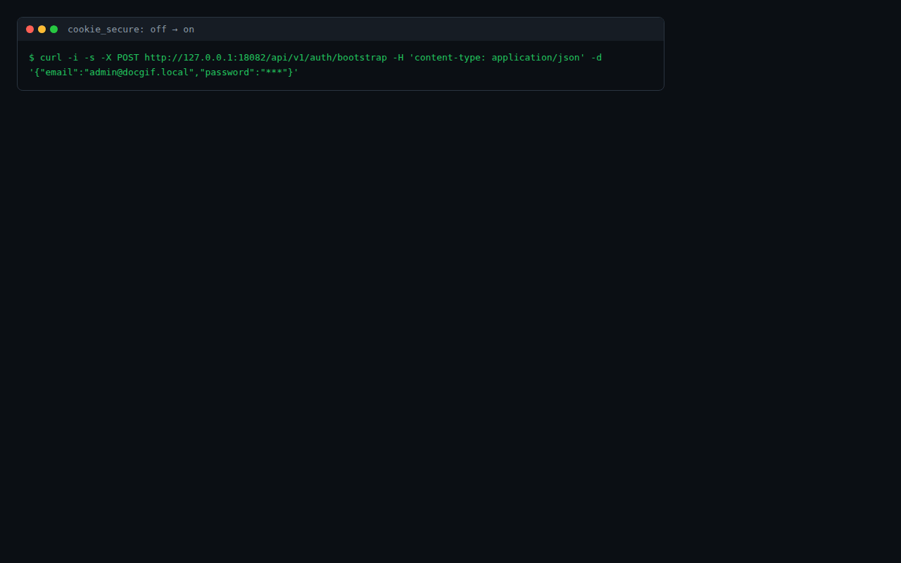
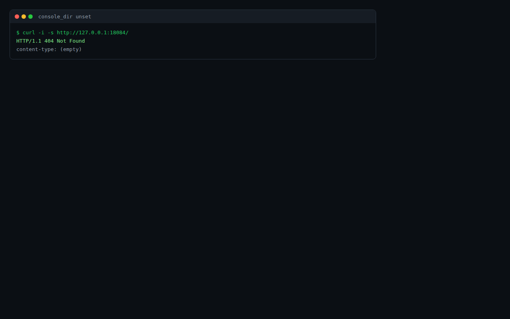
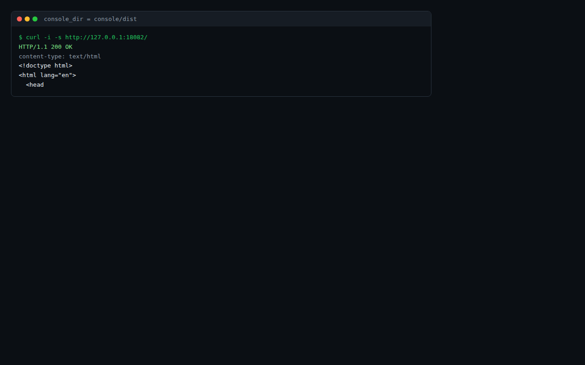
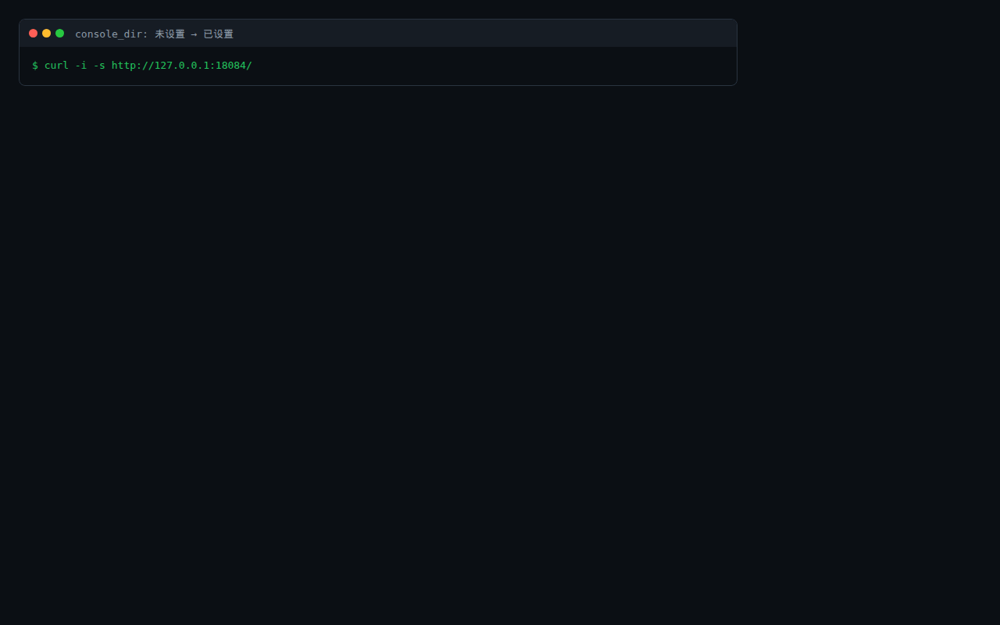

# 配置开关效果

Meshlet 每个「开启后有效果」的开关，附 off/on 截图与切换动图。证据由可复现捕获流水线（`scripts/doc-gif/run.sh`）生成——驱动真实 UI 与真实 HTTP 输出，**无手绘示意图**。同一流水线同时断言效果，故兼作配置效果回归测试：任一断言失败即非零退出。

## 证据如何生成

- GUI 类开关：用 headless Chromium（Playwright）驱动真实控制台，跨切换逐帧截图。
- Server/CLI 类开关：记录真实 HTTP 交换（实际的 `Set-Cookie` 头或状态行），渲染为终端录屏样式。
- 帧经 `ffmpeg`（palettegen/paletteuse）合成为 GIF。
- 随时重跑：`scripts/doc-gif/run.sh`（构建 console 与 server、在回环起临时实例、捕获、断言、写入 `docs/public/toggles/`）。

## 控制台主题（深色 ↔ 浅色）

控制台在未手动选择前跟随系统配色；选择存入 `localStorage['meshlet-theme']`（`console/src/theme/theme-provider.tsx`）。off = 深色（默认），on = 浅色。

| Off（深色） | On（浅色） |
| --- | --- |
|  |  |

## 控制台语言（English ↔ 中文）

控制台跟随浏览器语言（`zh*` → 中文，其余英文）直至手动更改；选择存入 `localStorage['meshlet-lang']`（`console/src/i18n/language-provider.tsx`）。off = English，on = 中文。

| Off（English） | On（中文） |
| --- | --- |
|  |  |

## Server `cookie_secure`

`cookie_secure = true` 时 server 配置为会话 Cookie 附加 `Secure` 属性（`apps/server/src/auth.rs`）。off = 无 `Secure`（仅 HTTP 也可用），on = `Secure`（浏览器仅在 HTTPS 下回传）。以下截图为 bootstrap 请求返回的**真实 `Set-Cookie` 头**。

| Off（cookie_secure = false） | On（cookie_secure = true） |
| --- | --- |
|  |  |

## Server `console_dir`

设置 `console_dir` 后 server 在 `/` 托管已构建的控制台；未设置时 `/` 返回 404。off = 未设置（404），on = 已设置（托管控制台包）。

| Off（未设置） | On（已设置） |
| --- | --- |
|  |  |

## 本机未能录制的开关

以下开关存在，但其效果需要本流水线无法驱动的宿主，故**不在上方 GIF 清单**（强行录制会产生误导性或不可能的捕获）。逐项如实标注可在何处录制：

- tray 应用：开机自启 / 动效 / 语言 —— 桌面 Tauri 窗口（系统托盘）。需 Windows 或 macOS 图形会话；本 Linux 主机无桌面显示。在桌面宿主运行 tray 应用并捕获其设置窗口（`apps/tray-app`）。
- agent `[dataplane] enabled` —— 效果是 agent 将 WireGuard 配置真正应用到真实接口（需 `NET_ADMIN` 与可达 hub）。用 `MESHLET_REQUIRE_DATAPLANE=1` 且具备数据面的宿主录制（见 ADR-007）。
- Agent `[dataplane.direct_connect] enabled` — **默认开启**（2026-11-06 起；显式 `enabled = false` 关闭）。效果 = 控制台拓扑页出现**实线直连边 + RTT 标注**（数据源：devices API 的 `direct_links[].connection_mode = p2p_direct`），以及各端 `wg show` 出现对端 `/32` 直连 peer。需真实第二台 meshlet 节点才能看到效果，本流水线（单机回环）无法录制；双真机走查已完成：coding-vm ↔ cuihaitao（Windows）经 Tailscale underlay 建立直连，拓扑 API 报 RTT 18ms（2026-11-06，证据见 todo.md P2P 账本）。
- Agent `[dataplane.probe] enabled` — **默认开启**（2026-11-13 起，spoke 事故后；显式 `enabled = false` 关闭；`crates/meshlet-config/src/agent.rs:273-284`，默认 5s / 20 样本窗口 / 连切 3 拍 / margin 30% / 连恢复 3 拍 / 劣化阈值 800ms）。效果 = 候选端点 ICMP 探测（SEL-001 采集本体），喂 SEL-002 迟滞切换闸与 SEL-003 晋升/降级闸；可见痕迹是 `{state_dir}/agent-decisions.jsonl` 的 `probe_window` 字段与 `probe` 动作（见[可观测性](../architecture/observability)）。本机单机回环无可探测候选端点，无法录制。
- 服务通知 / `status_notifier_item` —— 桌面托盘指示器，宿主限制同上。

以上均不冒充通过：列为本机暂不可录制，而非展示为「通过」。

## 可复现性

`scripts/doc-gif/run.sh` 是唯一入口：构建 console 与 server、起隔离回环实例、驱动捕获、断言效果、写入图片。因所有断言必须通过脚本才退出 0，配置变更破坏效果时流水线会以失败暴露——本页即配置效果回归测试。
